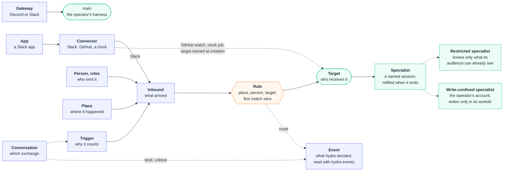

# Hydra

Talk to many Claude Code (or Codex) sessions from Slack or Discord. Each session gets its own thread and its own tmux window, so you can read it in chat or attach to the terminal.

**Example.** In your main thread: `spawn: fix the 5 easiest tech-debt tickets`. Hydra opens five threads (spark, pixel, glyph...), each with its own worktree. Each reports back to the main thread when done. To see what one is really doing: `tmux attach -t <name>`.

**Why not sub-agents?** A sub-agent hides inside one session. Here every session has a thread you can read, interrupt and steer, and sessions message each other.

- Commands: `spawn:`, `kill:`, `review <PR>` (a builder and an adversarial reviewer talk in a thread), `help` lists the rest. Session names are just unique IDs: a new session gets the catalog name used least recently (one never used first), and `session-<hex>` only when every name is held by a live session.
- Setup: see [Quick Start](#quick-start), then [Discord](docs/discord.md) or [Slack](docs/slack.md).

## Architecture

```
┌─────────────┐     ┌─────────────┐
│  Discord    │     │   Slack     │
│  Gateway    │     │  Gateway    │
│ (discord.js)│     │(@slack/bolt)│
└──────┬──────┘     └──────┬──────┘
       │                   │
       └────────┬──────────┘
                │
       ┌────────▼────────┐
       │     Daemon      │     Single process per platform.
       │  (daemon.ts)    │     Holds gateway connection,
       │                 │     routes messages, manages
       │  unix socket    │     sessions and access control.
       └────────┬────────┘
                │  newline-delimited JSON
       ┌────────▼────────┐
       │    Bridge       │     Thin MCP relay. One per
       │  (bridge.ts)    │     Claude session. Platform-
       │                 │     agnostic — doesn't import
       │  stdio ↔ socket │     any chat SDK.
       └────────┬────────┘
                │  MCP (stdio)
       ┌────────▼────────┐
       │   Claude Code   │     Full Claude with tools,
       │                 │     memory, file access, etc.
       └─────────────────┘
```

**Key design decisions:**
- **One gateway connection per platform.** Prevents token race conditions (Discord) and simplifies state.
- **Daemon ↔ Bridge separation.** The daemon is long-lived; Claude sessions come and go. The bridge reconnects automatically.
- **Platform selection via env var.** Set `CHAT_PLATFORM=discord` or `CHAT_PLATFORM=slack`. Default: `discord`.
- **Simultaneous platforms.** Run two daemons on different state dirs for Discord + Slack at the same time.

## Core abstractions

Twenty-three names carry the design. Each answers one question.

| Name | Question | Sentence |
|---|---|---|
| Gateway | How does the operator talk to hydra? | A chat platform (Discord or Slack) that carries the operator's messages and commands. One identity: its bot. |
| App | Who hears, who speaks? | A Slack app. Its bot hears where it is a member and is the only one that speaks. The operator's token, if given, hears every channel, DM and group DM the operator is in and never speaks; nothing it hears is delivered unless a place names it. A value that names one says its kind: `app:sales`. |
| App › router | Where does a tag go that nothing else takes? | `router = "main"` or `"specialist:<name>"` on a Slack app: a tag of the app in a channel thread that no binding and no rule takes goes to it, third in order. A specialist so named, the router, hears whoever its own `reachable_by` lets in, may bind the thread to another session, and is never restricted or write-confined. |
| Connector | Where does what arrives from outside come from? | A source of inbounds: Slack, GitHub, a clock. |
| Inbound | What arrived? | One thing that arrived, as routing sees it: who sent it, where, why it counts. |
| Place | Where did it happen? | A channel, a DM or a repository, named `slack:#ops`, `github:owner/repo`. |
| Person, roles | Who sent it? | A name from `[people]`, and the roles it holds. Written with their kind: `person:alice`, `role:finance`. |
| Conversation | Which exchange? | An app, a channel and a thread; what a binding attaches to. |
| Trigger | Why does it count? | The reason an inbound is heard: addressed (a tag or a DM), `messages = "all"`, or bound. |
| Reaction | A person's emoji on a message. | Heard only where the place says `reactions = "bot-messages"` or `"all"` (default `"off"`): then it is delivered, once, to the session that owns the conversation it is in, from a person the rules admit as for a message. |
| Rule | Which inbound goes to which target? | `place`, `person`, then `target`; the first match wins. |
| Target | Who receives it? | main (the operator's harness), a specialist, a session's thread, a conversation's own session, or a new session started from a recipe. A target value says its kind: `main`, `specialist:<name>`, `thread:<id>`. |
| Specialist | Who answers a place? | A named session that hydra refills when it ends. Reached by places, rules, schedules and deliveries. |
| Restricted specialist | What may it know? | A specialist that may know only what its audience can already see (`restricted = true`). A property of a specialist, not a kind of target, and never also write-confined. Its listed servers run under a sandbox proven only on the macOS versions hydra names: on any other, a restricted specialist that lists servers is refused at launch unless `[restricted] allow_unproven_macos = true`. |
| Write-confined specialist | Where may it write? | A specialist on the operator's account and tools whose Bash and Edit/Write writes are confined to its `workdir` (`can_only_write_to = "workdir"`; absent: writes anywhere). Claude Code's tools and shell are also denied the operator's credential places (below). The network, the browser's and MCP servers' own reads and writes, and anything not on that list stay open. A property of a specialist, like restricted, and never both: `Specialist` is restricted, write-confined or neither, and a hydra.toml table that sets both `restricted = true` and `can_only_write_to` does not load. |
| `cannot_read` | What more may it not read? | Paths added to the credential places a write-confined specialist's Claude Code tools and shell are always denied (`~/.ssh`, `~/.aws`, `~/.config/gh`, the keychain, browser profiles, hydra's state folder, other specialists' workdirs). Valid only with `can_only_write_to`; it extends, never replaces, the built-in places. Binds Claude Code's tools and shell, not the browser or MCP servers. |
| `handoff_at_pct` | At what context is its idle session replaced? | A specialist's context percent (1–99): an idle session of it at that line is replaced as its `handoff_protocol` says, whatever the environment says. Read on each health poll, so an edit reaches running sessions; not part of the launch policy, so a change never counts as drift. Its old name, `handoff_at`, fails to load and names the new one. On a restricted or write-confined specialist only with `kill_and_respawn`: their sessions have no handoff tool to write a letter with. |
| `handoff_protocol` | What replaces its session there? | `letter` (the default): the session writes a letter and a successor starts from it. `kill_and_respawn`: hydra ends the session and starts a fresh one in the same thread from the kickoff, with no letter, and no revive (a refill, `resume`, `respawn`, boot recovery) ever resumes or forks the old conversation. The `handoff` command follows it too. |
| Address | Who or where, on which platform? | `platform:thing`, like `slack:U0ALICE` or `slack:#ops`. A Person holds addresses; a Place is one. |
| Pin | Which apps deliver to it? | A specialist's list of Slack apps (`pinned_to`). Only those apps deliver to it, and it takes nothing from the others. |
| Operator | Whose hydra is it? | The Person (`operator = "…"`) whose DMs reach main and who reaches every specialist. |
| Event | What did hydra decide? | One line the daemon appends to `<state dir>/events/<day>.jsonl` when a message is delivered (or a tag is stopped), or a conversation is bound, moved or let go, by someone or by hydra itself with a reason: ids, names and a bind's reason, never message text. Slack routing only for now. Read with `hydra events` (`--kind`, `--since`, `--conversation`, `--by`, `--to`, `--limit`); day files older than `[events] keep_days` days (default 30) are deleted. Its `kind` is `route`, `bind` or `unbind`; a route's `via` is `binding`, `rule`, `router`, `operator-dm`, or, for a tag or a DM with the bot nothing delivered, `none` (no step took it: its sender was refused, no place hears it, or it tags an app that cannot hear it), `guard`, `tag-cap` or `table-full`. |
| Guard | May this sender's message go through? | The operator's command (`[guard]`) that judges a non-operator's Slack message after routing: deliver, redirect, hold or drop. |

A schedule is the one name for a clock that sends a message to a specialist; `job` is its old name. An audience is not a key: it is derived from who `reachable_by` lets reach a specialist, the places its `[[rules]]` send to it, and whether those places hear other bots (`bots = true` on the place).

In code: the gateways are `gateways/`, the Slack connector is `connectors/slack/`, an Inbound is `Inbound` in `routing/route.ts`, a Target is `Target` in `specialists/targets.ts`, and the restricted layer is `daemon/restricted.ts`. `diagrams/core.mmd` is the picture below; a test checks that every path and symbol named here and in `diagrams/core.mmd` exists.



**Route or name.** Route when the recipient depends on each event's sender and place: Slack, where a rule picks the target per event. Name the target when the subscriber chose it at creation: a GitHub watch or a clock job, set once.
Both end in `deliverToTarget`, so a restricted specialist's audience is checked the same way at delivery (`deliveryRefusal`).

## Prerequisites

- [Bun](https://bun.sh), the version `.tool-versions` pins — `asdf install`, or any install of that version. The daemon runs it whatever bun starts the CLI, and falls back to the bun on PATH, with a warning, when it is missing.
- [tmux](https://github.com/tmux/tmux) — `brew install tmux`
- [Claude Code](https://docs.anthropic.com/en/docs/claude-code) — `npm install -g @anthropic-ai/claude-code`

## Quick Start

```bash
# Install dependencies
bun install
claude plugin install discord@claude-plugins-official

# Create .env with your bot token and an existing working directory
mkdir -p ~/.claude/channels/discord
cat > ~/.claude/channels/discord/.env << 'EOF'
CHAT_PLATFORM=discord
DISCORD_BOT_TOKEN=your-token-here
SPAWN_CWD=~/your/project
EOF

# Run `claude` once: accept the onboarding screens and log in

# Install watchdog + verify setup
bun cli/hydra.ts install discord --cwd ~/your/project

# Say who you are (without this every DM is dropped): your Discord user id
bun cli/hydra.ts migrate discord --operator <your user id>

# Start
bun cli/hydra.ts up discord
```

## Platform Setup

- **[Discord Setup](docs/discord.md)** — bot creation, token, permissions, first operator
- **[Slack Setup](docs/slack.md)** — the Slack gateway (the operator's chat surface): app manifest, Socket Mode, tokens; and the Slack connector (events routed by hydra.toml)

## CLI Reference

All operations go through the `hydra` CLI (`bun cli/hydra.ts` or alias to `hydra`).

### Setup

```bash
hydra install <platform>       # Generate launchd watchdog, run preflight
hydra uninstall <platform>     # Remove launchd watchdog
hydra preflight <platform>     # Verify deployment is ready
```

The watchdog runs every 120s. It restarts the daemon when its tmux session is gone, when its heartbeat is more than 300s stale, or when it is spinning: 90% or more of a CPU core over the interval since the previous tick, two ticks in a row, the same definition the vitals tick uses for bridges and Claude (an event loop spinning in place starves its own timers, so the daemon can't catch this itself). The stale-heartbeat and CPU restarts wait while the platform's API is unreachable. Each restart is logged in `~/hydra-watchdog.log`. The third restart within an hour also sends you a DM listing them (or posts in the default channel if no one is allowlisted). The daemon sends it once it is connected again, since the watchdog has no chat connection of its own. A loop that keeps going is reported again about once an hour. An alert that waited more than an hour for a daemon to send it says how old it is.

The daemon's vitals tick (once a minute) also judges the host. **Overload**: 15-minute load at least 1.5 × cores *and* CPU idle under 15%, three ticks in a row; macOS load counts waiting threads, so high load with idle CPU is not overload. It is not judged for 20 minutes after the machine wakes from sleep; a stall of the daemon's own loop doesn't count as a wake where the OS can tell them apart (macOS), but elsewhere, or when that read fails, a stall of 60 s or more holds overload back too. **Memory** on macOS is the OS's own memory pressure level, since macOS swap total grows by whole swap files on demand, so used/total moves with allocation, not with pressure. Warn or critical three ticks in a row alerts; critical alerts at once, even after a warn alert, and counts as the warn alert too (its episode and cooldown), so no warn follows it. A tick with no level reading breaks the run of ticks but does not end the episode. Off macOS (Linux, with a fixed-size swap), memory is swap used at least 85% of the swap total, three ticks in a row. The alert shows swap used/total and lists the largest processes by resident memory with their session or parent. Each memory alert (on macOS, warn and critical separately) repeats at most once every 24 h while the daemon runs. Each alerts you once per episode, again only after it clears; an alert that is not delivered is tried again on a later tick that still holds, at most every 15 minutes. The vitals header in the daemon log shows the readings behind each verdict (`load15=`, `idle=`, `memory=`, `swap=used/total`). Thresholds are `[vitals]` in hydra.toml.

### Lifecycle

```bash
hydra up <platform>            # Start daemon + byte
hydra down <platform>          # Stop byte + daemon
hydra restart <platform>       # Restart daemon (picks up code changes)
```

### Session Management

```bash
hydra spawn <prompt>           # Spawn a new session
hydra list                     # List active sessions
hydra status <name>            # Session details
hydra kill <name>              # Kill a session
hydra kill <name> --destroy    # ...then delete its Discord thread (permanent; alias +d). Run from inside a session, only for sessions it spawned, as kill_session. <name> may be an ended session's name or a thread id, with [threads] allow_destroy
hydra peek [name]              # View live sessions (chooser or direct attach)
hydra health                   # Daemon diagnostics
hydra clear-key <key>          # Clear a stuck idempotency key
```

### Options

```
--daemon <name>                Target a specific daemon (else CHAT_PLATFORM picks among several running)
--json                         Output raw JSON
```

## Configuration

Four homes, each for one kind of fact. A fact lives in exactly one of them.

| Where | Holds | Who writes it |
|---|---|---|
| `<state dir>/.env` | **how the daemon runs**: `SPAWN_CWD`, `HYDRA_MODEL` (the model spawned sessions start with), bot tokens. Hydra holds every token for its own use (the gateway's, each Slack app's, each `[mcp_servers.*]` `token_env`) and removes it from the environment of every session it starts (the file itself stays readable by any session not confined away from it, and a token variable sessions need, like `GH_TOKEN`, cannot be removed: the loader warns); a restricted or write-confined session also unsets every other name this file sets except what a shell and Claude need (`PATH`, `HOME`, `LC_*`…), `HYDRA_*`, `CLAUDE_*`, `CHAT_PLATFORM`, `DISCORD_STATE_DIR` and `ANTHROPIC_API_KEY` (its engine's key stays readable by its shell); a name only the daemon's own shell exports is not covered | you |
| `<state dir>/hydra.toml` | **whom it serves**: the operator and the model main starts with (`[main] model`), the Discord gateway, people and roles, connectors, specialists and where they listen, schedules, rules, the guard, host-health thresholds | you; hydra re-reads it within a second of a change |
| `<state dir>/` state files (`sessions.json`, `threads.json`, `specialist-threads.json`, `jobs-state/`, `idempotency.json`, …) | **what it remembers** | hydra only; never edit by hand |
| a specialist's `workdir` | **what the agent knows**: its `CLAUDE.md`, `AGENTS.md`, skills and files | you and the agent; hydra never reads it |

The state dir is `~/.claude/channels/<platform>/` by default. Every `hydra.toml` key, with a one-line comment each, is in [`hydra.example.toml`](hydra.example.toml); a test loads it, so it stays current. To start from an existing install (`access.json`'s `allowFrom`, `specialists.json`, `slack-watch.json`), stop the daemon and run `hydra migrate <platform>` (`--dry-run` first shows what it would write). It keeps every file it changes as `*.migrated`, and an interrupted run is finished by running it again. A daemon refuses to start while `hydra.toml` sits beside old state it replaces, and says why in its log and in `hydra health`.

**A specialist's emoji.** `emoji = "🔐"` on a specialist is the glyph its sessions wear in their thread names, in place of the session's default emoji: `🔐 security audit · glyph`. It takes the default's position only, so the rest of the name is as before: a dead (`› ☠️`) or paused (`› ⏸`) session still shows that mark instead, a protocol badge still follows it, and the respawn count still trails. It is one emoji character (`:name:` and text are refused when hydra.toml loads, with what to write), is set per specialist (not in `[defaults.specialist]`), and applies at each session's next name update after an edit. Without it names are unchanged. `hydra specialist show` lists it.

**Destroying an ended session's thread.** `[threads] allow_destroy = true` lets `hydra kill <name or thread id> --destroy` (and main's `kill_session` with `thread_id` and `destroy: true`) delete the Discord thread of a session that has ended and left no record (a killed session; a crashed one that still has its record is destroyed as any live one is), or of a thread no session ever lived in, and clear its records (its `threads.json` entry, PR watches and bound conversations). Without it the command refuses and names the key; destroying a live session's thread (`kill +d`, `--destroy`, `destroy: true`) works either way. It never deletes a channel or DM, a specialist's home thread, or a thread a live session is in, and it deletes the thread's starting message only where hydra posted it.

**Main's model.** `[main] model` in hydra.toml is the model main (the operator's harness) starts with, written as a specialist's `model` is: a Claude alias (`opus`) or a full ID (`claude-opus-5-5[1m]`); main runs on Claude, so a Codex, omp or agy alias is a load error. Every start of main reads it (`hydra up`, a watchdog revival, the deprecated `start-byte.sh`), so an edit applies at main's next start (`hydra restart` restarts only the daemon: main takes it at `hydra down` then `hydra up`, or when the watchdog revives it); `hydra config check` shows it. Without it main starts on `HYDRA_MODEL`, else hydra's default, as spawned sessions do. A hydra.toml that does not load still starts main, on that default, and says why in the byte log.

**Restricting a specialist.** A specialist other people talk to should not run under the operator's account: whoever can message it can use everything it can. `restricted = true` gives it its folder, the built-in tools it lists (`Read`, `Grep`, `Glob` at most), the MCP servers its `mcp_servers` lists, each declared in `[mcp_servers.<name>]` (each with the `tools` of it that may be called and the `token_env` variables that reach it), and its own conversation, plus `send_to_thread` to the specialists its `sends_to` names (a question or an answer, quoted, cut at 1,500 characters and labelled by hydra, never to `main`). `[places."slack:#ops"]` takes `link_previews = false` to turn off Slack unfurls and Discord embeds on everything hydra posts there. Each new start of such a session is checked against its policy from Claude Code's own debug file, and it takes no message until it passes (its launch prompt itself reaches it); one that loaded anything else is stopped and refused in the thread. A session that was already running is not re-checked while it runs (#617). `link_previews` does not cover Slack edits. Listing a server means running code you trust with your own privileges. The server's `tools` list limits which of its tools the specialist may call; the recommended shape lists none. Each listed server also runs under a best-effort `sandbox-exec` profile on macOS (hygiene proven by probes, not containment; the network stays open and what is not on its list of off-limits places stays readable); where `sandbox-exec` is missing a specialist that lists servers is refused. A server that must keep data across sessions cannot run under it. See [the trust statement and its limits](docs/slack.md#listed-servers-code-you-trust-run-with-best-effort-hygiene). A restricted session's kickoff starts with a fixed preamble from hydra; it is a prompt, not a control. `restricted = false` is the default and changes nothing. A complete example, with what is refused and why: [Slack setup › A specialist other people talk to](docs/slack.md#a-specialist-other-people-talk-to-restricted--true); every key is in [`hydra.example.toml`](hydra.example.toml).

**Confining a specialist's writes.** A specialist that is one trusted person's assistant needs a shell, edits and a browser, and must not be able to wipe the operator's files. `can_only_write_to = "workdir"` (with `cannot_read`, below) keeps the operator's account and its built-in tools (narrowed by its own `tools` list) and sees only the MCP servers it lists, and starts every session (fresh, respawn, handoff successor, resume, fork) with Claude Code's own controls set in the launch settings: sandboxed Bash (Seatbelt), with writes limited to its `workdir` and Claude Code's own per-user `$TMPDIR` (on macOS `/tmp/claude-<uid>`; a shared `/tmp` is not writable, so a tool that hard-codes `/tmp` fails: point it at `$TMPDIR`; this is Claude Code's sandbox default, which hydra neither sets nor changes, seen on a live macOS run), no retry of a blocked command outside the sandbox, and no start on a machine where the sandbox cannot run; `permissions.blockWritesOutsideWorkingDirectories`, which makes Edit, Write and NotebookEdit refuse paths outside `workdir`; and, optionally, `deny_commands` (patterns for `Bash(...)` deny rules). Claude Code 2.1.314 or newer is required (older versions ignore the write block; hydra refuses to start one). Its `tools` (built-in tools, `--tools`; absent: all) and `mcp_servers` are its allowlist: it sees only the MCP servers it lists (plus hydra's bridge), by Claude Code's `allowedMcpServers` in the launch settings, with claude.ai connectors always off, and the start check refuses a session that started any other server; a service it needs is its own `[mcp_servers.<name>]` with its own `token_env`. `browser_profile` names that profile folder (inside the workdir, one per specialist, compared resolved and case-folded against every other specialist's profile and downloads folders at load, and checked again at every start; downloads go beside it as `<folder>-downloads`); it names the folder and does not confine the browser, which runs outside the sandbox and writes wherever the operator can. **The profile is in the specialist's own readable workdir**, so its confined shell and Read tool can read its own cookies and logins, and `files:` attach accepts it (the default `<workdir>/.browser` has always been that way); the folders are made 0700. Its `mcp_servers` list names servers hydra starts for it with their own browser profile and download folders, by default `<workdir>/.browser/profile` and `<workdir>/.browser/downloads`, given through the server's own `[mcp_servers.<name>]` declaration (`profile_args` and `profile_env`, with `{profile_dir}` and `{download_dir}` in them); those servers get these folders in place of the browser's default profile, which is the operator's. `can_only_write_to` always also denies Claude Code's own tools and shell reading `~/.ssh`, `~/.aws`, `~/.config/gh`, `~/.config/gcloud`, `~/.gnupg`, `~/.netrc`, `~/.npmrc`, `~/.docker`, `~/.kube`, the keychain, the browsers' own profiles (Chrome, Arc, Firefox, Brave, Edge, Safari, cookies), hydra's whole state folder (its token file, config and every session's generated MCP config with token values) and every other specialist's `workdir`, set as sandbox `denyRead` paths and `Read(...)` deny rules; `cannot_read` adds paths to that list and means nothing without `can_only_write_to`. `restricted = true` with either key is a load error. Because other specialists' workdirs are part of each one's list, adding, removing or moving any specialist changes every write-confined session's policy: each is replaced (`hydra kill`) before it takes a message again, which is accepted as the price of a list that cannot go stale. That binds Claude Code's tools and shell only: **the browser and MCP servers still read these places.** **The keychain.** `~/Library/Keychains` is in that list, and `security` reads a keychain file in its own process, so with the folder denied `security find-generic-password` and `git credential-osxkeychain` fail in the shell: shown with real Claude Code against a throwaway keychain (`daemon/__tests__/write-confinement-keychain.live.test.ts`), login keychain: not proven live (see the live check in the PR that added the test). The git helper cannot be told apart on the real keychain without writing an item, so it is proven on the throwaway only. A store that macOS's keychain service serves without the caller opening a file is not separately blocked, and Claude Code's own sandbox cannot block it: its profile always allows that service and its `allowMachLookup` setting can only add, and macOS refuses a second sandbox on top (found by reading Claude Code 2.1.326 and running `sandbox-exec` by hand, not by the test). Files sent to such a specialist are saved in `<workdir>/.inbox` (the shared inbox is under the denied state folder): the daemon makes the folder at 0700, refuses a link or file in its place, names each file itself (never overwriting or following a planted name; an extension something might act on is not kept; the bytes are written only after the folder is checked), and caps it at 200 files and 500 MB; the message names the path. Two of its sessions at once (a handoff successor started while its predecessor lives) share one locked browser profile. Files it attaches to a reply are checked by the daemon, which posts them outside the sandbox: only a file in its `workdir` or its temp folder and in none of the denied places goes, as a copy the daemon owns; it holds no tool that reaches another session (`spawn_session`, `peek_session`, `list_sessions`, `kill_session`, `send_to_thread`, `handoff`, `watch_pr`, `bind_conversation`), and its shell cannot connect to the daemon's socket (docs/slack.md says how that was shown and what it does not cover). `hydra specialist browser <name>` (run by the operator, never a session; a session may run it with `--dry-run`, which opens and writes nothing, and prints the login command, the profile folder and whether a declared lock file exists) opens that specialist's browser profile in a normal headed window once, to log it in: the command is the specialist's server's own `login_command` (first running the server's `setup_command`, if it declares one, to install its browser build), and it refuses while the profile's declared lock files exist (`profile_locks`) or unless the specialist is write-confined. It names no browser and never reads the profile; the profile is writable by the specialist's session, so run it before the first session (it refuses a folder something else filled unless `--trust-existing`). A listed server's `deny_tools` are tools of it the session may not call (each a `mcp__<server>__<tool>` deny rule, so Claude Code does not offer it): the server runs outside the sandbox, so what it can do, the session can ask it to, and a browser server's run-any-code tool is the case the example denies (docs/slack.md). **What it does not do:** other reads, the network and the operator's credentials stay open (the profile separates browser logins only; the keychain and `~/.ssh` are denied to Claude Code's tools and shell, not to the browser or a server, and the login keychain is unproven until the live check); MCP servers and the browser run outside Claude Code's sandbox, so what they write is not confined; a server from the operator's own Claude Code setup (a plugin, `~/.claude.json`, a project's `.mcp.json`) is not admitted, even under a listed server's name (the allowlist admits a listed server by its exact command). A managed MCP config (`managed-mcp.json`) declaring a listed name is refused, as is one that cannot be read (Claude Code's own text says its servers are admitted without listing; not shown live, the file is root-owned). Credential separation (`run_as`, a separate OS user) is planned and not built; this is not it. Your own `~/.claude/settings.json` can still add to the sandbox's allowed writes or excluded commands, because Claude Code merges those lists across settings files: hydra does not stop that, so keep them empty for a specialist you confine. The write block and the sandbox keys cannot be confirmed from Claude Code's debug file (the rules can, and every start is held until they show). `hydra config check` warns when someone can reach such a specialist, in those words. `can_only_write_to` with `restricted = true` is a load error; changing it for a running specialist is noticed like any policy change (a message to a running session born under the old setting is refused until `hydra kill` replaces it).

**Adding from another repo.** A repo that brings its own specialist and schedules ships them as a fragment: a TOML file of `[specialists.<id>]` and `[schedules.<id>]` tables, with the keys `hydra.example.toml` gives. Its setup runs `hydra config add <fragment.toml>` (`--dry-run` prints what it would append). That works while the daemon runs, which picks the change up within a second:
- a table hydra.toml doesn't have is appended after what's there, which is kept exactly;
- a table it already has, the same once loaded, is left alone, so a setup can run again;
- a table it has with different values is refused, with the edits to make by hand.

Nothing is written unless the result loads, and two writers at once (another `config add`, `hydra people add`) can't lose each other's change. Paths in a fragment are absolute or `~/…`. Without a hydra.toml it refuses: run `hydra migrate` first.

### Bot tokens

Set in `~/.claude/channels/<platform>/.env`:

```bash
# Discord
DISCORD_BOT_TOKEN=MTIz...

# Slack
SLACK_BOT_TOKEN=xoxb-...
SLACK_APP_TOKEN=xapp-...
```

### Access control

`hydra.toml` controls who can message the bot. Lives in the state dir (`~/.claude/channels/<platform>/` by default). The `operator` is the one person whose DMs reach `main` and who runs commands (`spawn:`, `kill:`, `/sessions`). `access.json` is gone: an old install runs `hydra migrate <platform>` once, which moves its people, channels and settings here and keeps the original as `access.json.migrated`. A new install runs `hydra migrate <platform> --operator <your user id>`.

```toml
operator = "operator"

[people.operator]
addresses = ["discord:184695080709324800"]   # platform user ids

# A channel the bot is in: the table existing admits it.
[places."discord:846209781206941736".access]
mention = true               # a top-level message must tag the bot (default true)
allow = ["anyone"]           # required: people from [people], or ["anyone"] for everyone who tags
listen = true                # a session thread started here listens without a tag

[gateways.discord]
ack_reaction = "👀"          # react to every message a session picks up
# off = true                 # drop every message that would reach a session; the operator's commands still run
```

To admit a channel, tag the bot there as the operator: it writes that table for you and runs the same message's command. Add a person with `hydra people add <name> <platform>:<id>`. Strangers' DMs are dropped (there is no pairing). `hydra config check <platform>` loads the file as the daemon does.

See [ACCESS.md](./ACCESS.md) for full reference.

### Running both platforms simultaneously

```bash
# Install both
hydra install discord
hydra install slack

# Start both
hydra up discord
hydra up slack
```

Each platform gets its own daemon, state dir, and watchdog. Use different `CLAUDE_CONFIG_DIR` values for separate logins.

### Voice dictation

Hydra can transcribe inbound audio attachments (Discord voice notes, Slack audio
clips) to text, so you can **dictate prompts** to Claude alongside text and images.

Transcription runs in a self-hosted sidecar (`transcribe-server/`) so audio never
leaves your machine. Claude doesn't accept audio natively, so the daemon
transcribes first and merges the text into the message as `[voice transcript] ...`;
the original audio file stays available in `downloaded_files`. Backend by platform:

- **macOS (Apple Silicon)** → **Parakeet-MLX** — NVIDIA Parakeet TDT on Apple's MLX
  runtime. Native, fast (~50× realtime), no GPU/CUDA. _Default on macOS._
- **Linux + NVIDIA GPU** → **Canary-Qwen 2.5B** via NeMo (top of the Open ASR
  leaderboard for English accuracy).

It's **on by default on the daemon side** — whenever a sidecar is reachable, voice
notes are transcribed; when it isn't, audio just passes through. So the only thing
to set up is the sidecar.

**Try it right now (no model install):**

```bash
./start-transcribe.sh mock     # GPU-free stub, returns a canned transcript
```

Send a voice note → Claude receives `[voice transcript] This is a mock transcription...`.
(The mock is manual-only: the daemon never auto-starts it, so a leftover mock
setting can't silently feed canned text into real messages. `hydra down` or
`tmux kill-session -t hydra-transcribe` stops it.)

**Real transcription (one-time; needs ffmpeg — `brew install ffmpeg`):**

```bash
./transcribe-server/setup.sh   # venv + the right backend for your platform
```

That's it. Once set up, the sidecar starts and stays up **with the daemon** —
`hydra up`, `start-daemon.sh`, and the watchdog all bring it along; `hydra down`
stops it. One shared tmux session (`hydra-transcribe`) serves every platform
daemon. Run `./start-transcribe.sh` to start it by hand. Set
`HYDRA_TRANSCRIBE_AUTOSTART=0` to keep the daemon from managing it, or `=1` to
force autostart even before setup (loud failure instead of a quiet skip).

If the sidecar is unreachable, the daemon logs it and delivers the message without a
transcript — dictation never blocks normal messages (a down sidecar fails fast; a
live-but-slow one delays only the voice message itself, up to
`HYDRA_TRANSCRIBE_TIMEOUT_MS`, 60s default). Disable entirely with
`HYDRA_TRANSCRIBE_ENABLED=0`. Full setup, env vars, and tuning:
[`transcribe-server/README.md`](transcribe-server/README.md).

## Tools

| Tool | Description |
|------|-------------|
| `reply` | Send a message. Takes `chat_id` + `text`, optionally `reply_to` for threading and `files` for attachments (max 10, 25MB each). Auto-chunks long messages. |
| `react` | Add emoji reaction to a message. |
| `edit_message` | Edit a previously sent message. With a Slack conversation as `chat_id`, `message_id` is the message's ts: the operator's own and any app's bot's, in any conversation; a restricted specialist only its own app's, in one bound to it (see [Slack setup](docs/slack.md#editing-and-deleting-slack-messages)). |
| `fetch_messages` | Pull recent history (up to 100). |
| `download_attachment` | Download attachments from a message to local inbox. |
| `create_thread` | Create a thread on a message or standalone. |
| `spawn_session` | Spawn a new Claude session for a topic (main session only). |
| `list_sessions` | List active spawned sessions (main session only). |
| `kill_session` | Kill a session you spawned (main: any). `destroy: true` also deletes its Discord thread, through the same step as `kill +d`; a session may destroy only a thread hydra created for that spawn and no other session answers in, else it is refused before anything is killed. Main alone may pass `thread_id` and `destroy: true` for a thread no live session is in; that needs `[threads] allow_destroy`. |

## Sessions

Spawn isolated Claude sessions from chat:

| Command | Action |
|---------|--------|
| `spawn: <topic>` | Create a new session with a thread |
| `kill: <name>` | Kill a session by name |
| `kill +d` (in a thread) | Kill this thread's session, then delete the thread |
| `/sessions` | List active sessions |
| `listen` / `pause` | Toggle auto-routing in a session thread |
| `help` / `commands` | Show all available commands |

Sessions get cute names (spark, pixel, nova...) and run in their own tmux sessions. State persists across daemon restarts.

### Idle reaping

An ephemeral session (`hydra spawn --ephemeral`, and every `jobs.toml` spawn) is nudged after 30 minutes with no one posting in its thread (`--idle-ttl` / `idle_ttl` sets its own, up to 7d), then ended 5 minutes later unless someone replies.

`HYDRA_IDLE_REAP_DAYS=<days>` in the state dir's `.env` (off by default; a positive number such as `7` or `1.5`; a change takes a restart) does the same for every other spawned session idle that long. Exempt: byte, thread guests, a specialist's session and any session in a protocol run.

- **Idle** means nothing was delivered to it, it called no Hydra tool (`reply`, `send_to_thread`, …), and it isn't busy at that moment: working, blocked at a permission or plan prompt, or running a background shell.
- **A fresh window instead** goes to a session that is busy, has a live session it spawned, or has a message from a person in its thread newer than its last reply there. It isn't ended before it answers, or while a child may still report to it.
- **Ended the way a crash leaves a session:** its record, worktree, scratchpads and PR watches are kept, and automatic recovery at the next daemon start skips it. The nudge, the thread notice and the closing message all say how to come back: typing `resume` in the thread continues the conversation.
- **The first start with the setting** gives every session a fresh window, so nothing is ended at once.

### PR watching

`watch [pr-url]` in a session thread watches a PR (no URL: the PR for the session's current branch). The daemon polls every 3 minutes and delivers new review feedback and CI failures to the session. `unwatch <pr-url>` stops; `watches` lists them.

Add `+green` (`watch <pr-url> +green`, or `watch_pr` with `notify_green: true`) to also post `✅ CI green` in the thread when CI passes, once per head commit. It is a plain thread message, not a session turn. Using it on an already-watched PR turns it on for that watch; `watches` marks these with 🟢.

### Specialists

Long-lived, named sessions declared in `hydra.toml`, refilled automatically. Declaring, changing and retiring them: [docs/specialists.md](docs/specialists.md).

### Slack connector: routing from hydra.toml

Slack as an event source: `hydra.toml` routes each message to a specialist, with access roles, guards and catch-up. See [docs/slack-connector.md](docs/slack-connector.md).

### Schedules (formerly jobs)

Cron-style `[schedules.<id>]` tables that deliver a prompt or run a command on a timer. See [docs/schedules.md](docs/schedules.md).

### Usage alerts

The daemon posts account-wide Claude rate-limit alerts to the default channel: the 5-hour window at 80% and 95%, the weekly window at 80%, 90% and 95%, once per threshold. They re-arm when the window resets, or when usage falls well below the last alert. The figures come from Claude Code itself: the hydra mod (`mod/`) in byte reports each change through the main-only `report_usage` tool. Byte's footer ("You've used N% of your weekly limit") is a fallback for the weekly window while the mod is not reporting; both feed one dedupe (`daemon/usage-alerts.ts`), persisted in the state dir so a restart does not re-alert.

### Handoff

`handoff [model][: note]` in a session thread makes the session write a handoff file; a fresh session continues in the same thread and worktree, optionally on another model. Templates, auto-handoff settings and the `pre-handoff` hook: [docs/handoff.md](docs/handoff.md).

### Session environment

Each Claude, omp or agy session that hydra spawns has its identity in its own environment: `HYDRA_SESSION_ID`, `HYDRA_SESSION_NAME`, `HYDRA_THREAD_ID` and `HYDRA_SESSION_TYPE` (not main, not codex). A Claude Code hook can read its thread from there without calling the daemon. A `spawn_session fork_from` fork gets a new thread; a handoff successor, a resume, a respawn and a recovered session keep their thread; a protocol guest gets the thread it joined, with type `thread_guest`. An unknown value is empty. A session launched before this change has none of the last two, so treat unset as empty. A restricted specialist's session also has `HYDRA_RESTRICTED=1`; its type is `thread_owner`, like any other owner.

### Forking sessions

`spawn_session(fork_from=...)` starts from a copy of another session's conversation; handoff successors get `ask_predecessor`. See [docs/forking.md](docs/forking.md).

**Google models.** `spawn neon: topic` runs a session on Google's Antigravity CLI (`agy`) in tmux. Setup, aliases, how it works and its limits: [docs/agy.md](docs/agy.md).

### Exit codes and result words

Exit codes of `hydra` commands and the result words `hydra deliver` prints. See [docs/exit-codes.md](docs/exit-codes.md).

## Troubleshooting

Symptoms first — each maps to one root cause. See [docs/ONBOARDING_TIPS.md](./docs/ONBOARDING_TIPS.md) for a full first-machine checklist.

**Bot is online but a spawned thread stays empty, or `spawn:` does nothing.**
Command interception (`spawn:`, `kill:`, `/sessions`, `/health`) fires only for the **operator** in `hydra.toml`. A channel's `allow` list lets *replies* through; *commands* need you to be the operator. → `hydra migrate <platform> --operator <your user id>` on a new install, or check `operator = "…"` and that person's `addresses`. (The daemon logs `command-shaped message from non-allowlisted sender …` when this happens.)

**Byte or spawned session hangs on a theme picker, login, or "trust this folder" screen.**
The byte is a second, headless Claude in tmux using `CLAUDE_CONFIG_DIR` (default `~/.claude`), so it reads **`$CLAUDE_CONFIG_DIR/.claude.json`** — not `~/.claude.json`. A fresh config dir triggers first-run gates that block a detached session. → Complete them once via `tmux attach -t <platform>-byte`, or pre-seed `theme`, `hasCompletedOnboarding`, `bypassPermissionsModeAccepted`, and per-project `hasTrustDialogAccepted`. `hydra preflight` now flags this.

**Bot connects but never sees inbound (looks healthy, ignores everyone).**
→ Enable **Message Content Intent** (Developer Portal → Bot → Privileged Gateway Intents), or the bot receives empty message content.

**A spawned session runs but its bridge never connects (no `plugin:discord:discord` lines in its debug log).**
Claude Code keeps `$CLAUDE_CONFIG_DIR/mcp-needs-auth-cache.json`, and while it holds an entry for a server (~15 min) every new Claude process sharing that config dir skips the server silently. The daemon removes the bridge's own entry before every launch it makes and logs `cleared Claude Code needs-auth cache entry for plugin:discord:discord (set Nm ago) before launching <name>`; a session that still ends up bridgeless says "Claude Code had the bridge marked needs-auth (cleared at launch)" in its thread. The byte is launched outside the daemon, so if the byte is the one without a bridge, delete that key by hand and restart it.

**Byte dies instantly, or spawns fail to launch.**
→ Check `SPAWN_CWD` points at a directory that exists. Inspect `~/hydra-<platform>-byte.log` and `~/hydra-<platform>-daemon.log`.

**`usage` shows `?` instead of context percentage.**
The daemon takes a Claude session's context from its transcript: the last turn's input and cache tokens over the window of the model the session was launched with (1M for a `[1m]` model). For the byte, it is the model `hydra up` records when it launches it (`main.json` in the state dir). The daemon reads the footer below the input box only when it can't do that (no recorded or an unrecognized launch model, or no transcript yet), so `?` means neither was there.

Every session hydra launches (the byte, spawned and restricted sessions) loads hydra's mod (`mod/`), which puts Claude Code's own context fill in that footer after each response: `hydra: ctx: N%`, the session's `used_percentage`. No statusline script is needed. The daemon's footer reader recognizes `ctx: N%`, or a progress bar followed by `N%` (e.g. `█████░░░░░ 54%`); `ctx:` wins when both are there. Percentages anywhere else on screen (conversation text, Claude Code's own "Context left until auto-compact" line, which counts *remaining*) are ignored.

**`usage` disagrees with your statusline.**
`usage` and the context alerts (at 50% and 70%; every line hydra acts on is listed in `docs/handoff.md` under "Context lines") use the transcript count wherever there is one, and the footer number on the fallback; the transcript count matches the mod's `ctx: N%` while a session runs on the model it was launched with (after a `/model` switch to another model, or once the context passes the launch window, the transcript cannot name the window, so the daemon reads the `ctx: N%` footer instead and logs that it did; a switch between a model and its `[1m]` form shows only as the second case). A statusline of your own that rescales reads higher (one that maps the auto-compact point to 100% reads about 1.2× the raw figure). Only a `ctx: N%` footer is checked against the transcript: when the two differ by 2 points or more, the daemon logs `context %: <name> transcript says N% (used/window), pane says M%`, at most once every 10 minutes per session.

**Verify inbound end-to-end:** `grep -E "main bridge connected|running tmux new-session" ~/hydra-<platform>-daemon.log`

## Files

| File | Purpose |
|------|---------|
| `gateways/gateway.ts` | ChatGateway interface and shared types |
| `gateways/discord.ts` | The Discord gateway: the operator's chat surface on Discord (discord.js) |
| `gateways/slack.ts` | The Slack gateway: the operator's chat surface on Slack (@slack/bolt Socket Mode; `CHAT_PLATFORM=slack`) |
| `connectors/slack/` | The Slack connector: Slack as a source of events, routed by hydra.toml, one connection per app (`listener.ts` is one app's connection) |
| `daemon.ts` | Platform-agnostic message router and session manager |
| `bridge.ts` | MCP relay between Claude and daemon (unix socket ↔ stdio) |
| `cli/hydra.ts` | CLI entry point — routes commands |
| `cli/helpers.ts` | Config resolution, tmux wrappers, socket comms, compile check |
| `cli/lifecycle.ts` | Lifecycle commands: up/down/restart/watchdog/preflight/install |
| `cli/peek.ts` | View live sessions via tmux linked windows with filtered chooser |

Logs land at `~/hydra-<platform>-daemon.log` and `~/hydra-<platform>-byte.log`.
