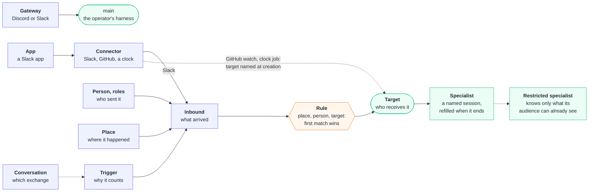

# Hydra

A new interface to building — run coding agents over Discord/Slack.

- Spawn and manage parallel agents from chat
- tmux in to manage from terminal

## Architecture

```
┌─────────────┐     ┌─────────────┐
│  Discord    │     │   Slack     │
│  Gateway    │     │  Gateway    │
│ (discord.js)│     │(@slack/bolt)│
└──────┬──────┘     └──────┬──────┘
       │                   │
       └────────┬──────────┘
                │
       ┌────────▼────────┐
       │     Daemon      │     Single process per platform.
       │  (daemon.ts)    │     Holds gateway connection,
       │                 │     routes messages, manages
       │  unix socket    │     sessions and access control.
       └────────┬────────┘
                │  newline-delimited JSON
       ┌────────▼────────┐
       │    Bridge       │     Thin MCP relay. One per
       │  (bridge.ts)    │     Claude session. Platform-
       │                 │     agnostic — doesn't import
       │  stdio ↔ socket │     any chat SDK.
       └────────┬────────┘
                │  MCP (stdio)
       ┌────────▼────────┐
       │   Claude Code   │     Full Claude with tools,
       │                 │     memory, file access, etc.
       └─────────────────┘
```

**Key design decisions:**
- **One gateway connection per platform.** Prevents token race conditions (Discord) and simplifies state.
- **Daemon ↔ Bridge separation.** The daemon is long-lived; Claude sessions come and go. The bridge reconnects automatically.
- **Platform selection via env var.** Set `CHAT_PLATFORM=discord` or `CHAT_PLATFORM=slack`. Default: `discord`.
- **Simultaneous platforms.** Run two daemons on different state dirs for Discord + Slack at the same time.

## Core abstractions

Sixteen names carry the design. Each answers one question.

| Name | Question | Sentence |
|---|---|---|
| Gateway | How does the operator talk to hydra? | A chat platform (Discord or Slack) that carries the operator's messages and commands. One identity: its bot. |
| App | Who hears, who speaks? | A Slack app. Its bot hears where it is a member and is the only one that speaks. The operator's token, if given, hears every channel, DM and group DM the operator is in and never speaks; nothing it hears is delivered unless a place names it. A value that names one says its kind: `app:sales`. |
| Connector | Where do events from outside come from? | A source of events: Slack, GitHub, a clock. |
| Inbound | What arrived? | One event as routing sees it: who sent it, where, why it counts. |
| Place | Where did it happen? | A channel, a DM or a repository, named `slack:#ops`, `github:owner/repo`. |
| Person, roles | Who sent it? | A name from `[people]`, and the roles it holds. Written with their kind: `person:alice`, `role:finance`. |
| Conversation | Which exchange? | An app, a channel and a thread; what a binding attaches to. |
| Trigger | Why does it count? | The reason an inbound is heard: addressed (a tag or a DM), `messages = "all"`, or bound. |
| Reaction | A person's emoji on a message. | Heard only where the place says `reactions = "bot-messages"` or `"all"` (default `"off"`): then it is delivered, once, to the session that owns the conversation it is in, from a person the rules admit as for a message. |
| Rule | Which inbound goes to which target? | `place`, `person`, then `target`; the first match wins. |
| Target | Who receives it? | main (the operator's harness), a specialist, a session's thread, a conversation's own session, or a new session started from a recipe. A target value says its kind: `main`, `specialist:<name>`, `thread:<id>`. |
| Specialist | Who answers a place? | A named session that hydra refills when it ends. Reached by places, rules, schedules and deliveries. |
| Restricted specialist | What may it know? | A specialist that may know only what its audience can already see (`restricted = true`). A property of a specialist, not a kind of target. Its listed servers run under a sandbox proven only on the macOS versions hydra names: on any other, a restricted specialist that lists servers is refused at launch unless `[restricted] allow_unproven_macos = true`. |
| Write-confined specialist | Where may it write? | A specialist on the operator's account and tools whose Bash and Edit/Write writes are confined to its `workdir` (`can_only_write_to = "workdir"`; absent: writes anywhere). Claude Code's tools and shell are also denied the operator's credential places (below). The network, the browser's and MCP servers' own reads and writes, and anything not on that list stay open. A property of a specialist, like restricted, and never both. |
| `cannot_read` | What more may it not read? | Paths added to the credential places a write-confined specialist's Claude Code tools and shell are always denied (`~/.ssh`, `~/.aws`, `~/.config/gh`, the keychain, browser profiles, hydra's state folder, other specialists' workdirs). Valid only with `can_only_write_to`; it extends, never replaces, the built-in places. Binds Claude Code's tools and shell, not the browser or MCP servers. |
| Address | Who or where, on which platform? | `platform:thing`, like `slack:U0ALICE` or `slack:#ops`. A Person holds addresses; a Place is one. |
| Pin | Which apps deliver to it? | A specialist's list of Slack apps (`pinned_to`). Only those apps deliver to it, and it takes nothing from the others. |
| Operator | Whose hydra is it? | The Person (`operator = "…"`) whose DMs reach main and who reaches every specialist. |
| Guard | May this sender's message go through? | The operator's command (`[guard]`) that judges a non-operator's Slack message after routing: deliver, redirect, hold or drop. |

A schedule is the one name for a clock that sends a message to a specialist; `job` is its old name. An audience is not a key: it is derived from who `reachable_by` lets reach a specialist, the places its `[[rules]]` send to it, and whether those places hear other bots (`bots = true` on the place).

In code: the gateways are `gateways/`, the Slack connector is `connectors/slack/`, an Inbound is `Inbound` in `routing/route.ts`, a Target is `Target` in `specialists/targets.ts`, and the restricted layer is `daemon/restricted.ts`. `diagrams/core.mmd` is the picture below; a test checks that every path and symbol named here and in `diagrams/core.mmd` exists.



**Route or name.** Route when the recipient depends on each event's sender and place: Slack, where a rule picks the target per event. Name the target when the subscriber chose it at creation: a GitHub watch or a clock job, set once.
Both end in `deliverToTarget`, so a restricted specialist's audience is checked the same way at delivery (`deliveryRefusal`).

## Prerequisites

- [Bun](https://bun.sh), the version `.tool-versions` pins — `asdf install`, or any install of that version. The daemon runs it whatever bun starts the CLI, and falls back to the bun on PATH, with a warning, when it is missing.
- [tmux](https://github.com/tmux/tmux) — `brew install tmux`
- [Claude Code](https://docs.anthropic.com/en/docs/claude-code) — `npm install -g @anthropic-ai/claude-code`

## Quick Start

```bash
# Install dependencies
bun install
claude plugin install discord@claude-plugins-official

# Create .env with your bot token and an existing working directory
mkdir -p ~/.claude/channels/discord
cat > ~/.claude/channels/discord/.env << 'EOF'
CHAT_PLATFORM=discord
DISCORD_BOT_TOKEN=your-token-here
SPAWN_CWD=~/your/project
EOF

# Run `claude` once: accept the onboarding screens and log in

# Install watchdog + verify setup
bun cli/hydra.ts install discord --cwd ~/your/project

# Start
bun cli/hydra.ts up discord
```

## Platform Setup

- **[Discord Setup](docs/discord.md)** — bot creation, token, permissions, pairing
- **[Slack Setup](docs/slack.md)** — the Slack gateway (the operator's chat surface): app manifest, Socket Mode, tokens; and the Slack connector (events routed by hydra.toml)

## CLI Reference

All operations go through the `hydra` CLI (`bun cli/hydra.ts` or alias to `hydra`).

### Setup

```bash
hydra install <platform>       # Generate launchd watchdog, run preflight
hydra uninstall <platform>     # Remove launchd watchdog
hydra preflight <platform>     # Verify deployment is ready
```

The watchdog runs every 120s. It restarts the daemon when its tmux session is gone, when its heartbeat is more than 300s stale, or when it is spinning: 90% or more of a CPU core over the interval since the previous tick, two ticks in a row, the same definition the vitals tick uses for bridges and Claude (an event loop spinning in place starves its own timers, so the daemon can't catch this itself). The stale-heartbeat and CPU restarts wait while the platform's API is unreachable. Each restart is logged in `~/hydra-watchdog.log`. The third restart within an hour also sends you a DM listing them (or posts in the default channel if no one is allowlisted). The daemon sends it once it is connected again, since the watchdog has no chat connection of its own. A loop that keeps going is reported again about once an hour. An alert that waited more than an hour for a daemon to send it says how old it is.

The daemon's vitals tick (once a minute) also judges the host. **Overload**: 15-minute load at least 1.5 × cores *and* CPU idle under 15%, three ticks in a row; macOS load counts waiting threads, so high load with idle CPU is not overload. It is not judged for 20 minutes after the machine wakes from sleep; a stall of the daemon's own loop doesn't count as a wake where the OS can tell them apart (macOS), but elsewhere, or when that read fails, a stall of 60 s or more holds overload back too. **Memory** on macOS is the OS's own memory pressure level, since macOS swap total grows by whole swap files on demand, so used/total moves with allocation, not with pressure. Warn or critical three ticks in a row alerts; critical alerts at once, even after a warn alert, and counts as the warn alert too (its episode and cooldown), so no warn follows it. A tick with no level reading breaks the run of ticks but does not end the episode. Off macOS (Linux, with a fixed-size swap), memory is swap used at least 85% of the swap total, three ticks in a row. The alert shows swap used/total and lists the largest processes by resident memory with their session or parent. Each memory alert (on macOS, warn and critical separately) repeats at most once every 24 h while the daemon runs. Each alerts you once per episode, again only after it clears; an alert that is not delivered is tried again on a later tick that still holds, at most every 15 minutes. The vitals header in the daemon log shows the readings behind each verdict (`load15=`, `idle=`, `memory=`, `swap=used/total`). Thresholds are `[vitals]` in hydra.toml.

### Lifecycle

```bash
hydra up <platform>            # Start daemon + byte
hydra down <platform>          # Stop byte + daemon
hydra restart <platform>       # Restart daemon (picks up code changes)
```

### Session Management

```bash
hydra spawn <prompt>           # Spawn a new session
hydra list                     # List active sessions
hydra status <name>            # Session details
hydra kill <name>              # Kill a session
hydra kill <name> --destroy    # ...then delete its Discord thread (permanent; alias +d). Run from inside a session, only for sessions it spawned, as kill_session. <name> may be an ended session's name or a thread id, with [threads] allow_destroy
hydra peek [name]              # View live sessions (chooser or direct attach)
hydra health                   # Daemon diagnostics
hydra clear-key <key>          # Clear a stuck idempotency key
```

### Options

```
--daemon <name>                Target a specific daemon (else CHAT_PLATFORM picks among several running)
--json                         Output raw JSON
```

## Configuration

Four homes, each for one kind of fact. A fact lives in exactly one of them.

| Where | Holds | Who writes it |
|---|---|---|
| `<state dir>/.env` | **how the daemon runs**: `SPAWN_CWD`, `HYDRA_MODEL` (the model spawned sessions start with), bot tokens | you |
| `<state dir>/hydra.toml` | **whom it serves**: the operator and the model main starts with (`[main] model`), the Discord gateway, people and roles, connectors, specialists and where they listen, schedules, rules, the guard, host-health thresholds | you; hydra re-reads it within a second of a change |
| `<state dir>/` state files (`sessions.json`, `threads.json`, `specialist-threads.json`, `jobs-state/`, `idempotency.json`, …) | **what it remembers** | hydra only; never edit by hand |
| a specialist's `workdir` | **what the agent knows**: its `CLAUDE.md`, `AGENTS.md`, skills and files | you and the agent; hydra never reads it |

The state dir is `~/.claude/channels/<platform>/` by default. Every `hydra.toml` key, with a one-line comment each, is in [`hydra.example.toml`](hydra.example.toml); a test loads it, so it stays current. To start from an existing install (`access.json`'s `allowFrom`, `specialists.json`, `slack-watch.json`), stop the daemon and run `hydra migrate <platform>` (`--dry-run` first shows what it would write). It keeps every file it changes as `*.migrated`, and an interrupted run is finished by running it again. A daemon refuses to start while `hydra.toml` sits beside old state it replaces, and says why in its log and in `hydra health`.

**A specialist's emoji.** `emoji = "🔐"` on a specialist is the glyph its sessions wear in their thread names, in place of the session's default emoji: `🔐 security audit · glyph`. It takes the default's position only, so the rest of the name is as before: a dead (`› ☠️`) or paused (`› ⏸`) session still shows that mark instead, a protocol badge still follows it, and the respawn count still trails. It is one emoji character (`:name:` and text are refused when hydra.toml loads, with what to write), is set per specialist (not in `[defaults.specialist]`), and applies at each session's next name update after an edit. Without it names are unchanged. `hydra specialist show` lists it.

**Destroying an ended session's thread.** `[threads] allow_destroy = true` lets `hydra kill <name or thread id> --destroy` (and main's `kill_session` with `thread_id` and `destroy: true`) delete the Discord thread of a session that has ended and left no record (a killed session; a crashed one that still has its record is destroyed as any live one is), or of a thread no session ever lived in, and clear its records (its `threads.json` entry, PR watches and bound conversations). Without it the command refuses and names the key; destroying a live session's thread (`kill +d`, `--destroy`, `destroy: true`) works either way. It never deletes a channel or DM, a specialist's home thread, or a thread a live session is in, and it deletes the thread's starting message only where hydra posted it.

**Main's model.** `[main] model` in hydra.toml is the model main (the operator's harness) starts with, written as a specialist's `model` is: a Claude alias (`opus`) or a full ID (`claude-opus-5-5[1m]`); main runs on Claude, so a Codex or omp alias is a load error. Every start of main reads it (`hydra up`, a watchdog revival, the deprecated `start-byte.sh`), so an edit applies at main's next start (`hydra restart` restarts only the daemon: main takes it at `hydra down` then `hydra up`, or when the watchdog revives it); `hydra config check` shows it. Without it main starts on `HYDRA_MODEL`, else hydra's default, as spawned sessions do. A hydra.toml that does not load still starts main, on that default, and says why in the byte log.

**Restricting a specialist.** A specialist other people talk to should not run under the operator's account: whoever can message it can use everything it can. `restricted = true` gives it its folder, the built-in tools it lists (`Read`, `Grep`, `Glob` at most), the MCP servers its `mcp_servers` lists, each declared in `[mcp_servers.<name>]` (each with the `tools` of it that may be called and the `token_env` variables that reach it), and its own conversation, plus `send_to_thread` to the specialists its `sends_to` names (a question or an answer, quoted, cut at 1,500 characters and labelled by hydra, never to `main`). `[places."slack:#ops"]` takes `link_previews = false` to turn off Slack unfurls and Discord embeds on everything hydra posts there. Each new start of such a session is checked against its policy from Claude Code's own debug file, and it takes no message until it passes (its launch prompt itself reaches it); one that loaded anything else is stopped and refused in the thread. A session that was already running is not re-checked while it runs (#617). `link_previews` does not cover Slack edits. Listing a server means running code you trust with your own privileges. The server's `tools` list limits which of its tools the specialist may call; the recommended shape lists none. Each listed server also runs under a best-effort `sandbox-exec` profile on macOS (hygiene proven by probes, not containment; the network stays open and what is not on its list of off-limits places stays readable); where `sandbox-exec` is missing a specialist that lists servers is refused. A server that must keep data across sessions cannot run under it. See [the trust statement and its limits](docs/slack.md#listed-servers-code-you-trust-run-with-best-effort-hygiene). A restricted session's kickoff starts with a fixed preamble from hydra; it is a prompt, not a control. `restricted = false` is the default and changes nothing. A complete example, with what is refused and why: [Slack setup › A specialist other people talk to](docs/slack.md#a-specialist-other-people-talk-to-restricted--true); every key is in [`hydra.example.toml`](hydra.example.toml).

**Confining a specialist's writes.** A specialist that is one trusted person's assistant needs a shell, edits and a browser, and must not be able to wipe the operator's files. `can_only_write_to = "workdir"` (with `cannot_read`, below) keeps the operator's account and its built-in tools (narrowed by its own `tools` list) and sees only the MCP servers it lists, and starts every session (fresh, respawn, handoff successor, resume, fork) with Claude Code's own controls set in the launch settings: sandboxed Bash (Seatbelt), with writes limited to its `workdir` and Claude Code's own per-user `$TMPDIR` (on macOS `/tmp/claude-<uid>`; a shared `/tmp` is not writable, so a tool that hard-codes `/tmp` fails: point it at `$TMPDIR`; this is Claude Code's sandbox default, which hydra neither sets nor changes, seen on a live macOS run), no retry of a blocked command outside the sandbox, and no start on a machine where the sandbox cannot run; `permissions.blockWritesOutsideWorkingDirectories`, which makes Edit, Write and NotebookEdit refuse paths outside `workdir`; and, optionally, `deny_commands` (patterns for `Bash(...)` deny rules). Claude Code 2.1.314 or newer is required (older versions ignore the write block; hydra refuses to start one). Its `tools` (built-in tools, `--tools`; absent: all) and `mcp_servers` are its allowlist: it sees only the MCP servers it lists (plus hydra's bridge), by Claude Code's `allowedMcpServers` in the launch settings, with claude.ai connectors always off, and the start check refuses a session that started any other server; a service it needs is its own `[mcp_servers.<name>]` with its own `token_env`. `browser_profile` names that profile folder (inside the workdir, one per specialist, compared resolved and case-folded against every other specialist's profile and downloads folders at load, and checked again at every start; downloads go beside it as `<folder>-downloads`); it names the folder and does not confine the browser, which runs outside the sandbox and writes wherever the operator can. **The profile is in the specialist's own readable workdir**, so its confined shell and Read tool can read its own cookies and logins, and `files:` attach accepts it (the default `<workdir>/.browser` has always been that way); the folders are made 0700. Its `mcp_servers` list names servers hydra starts for it with their own browser profile and download folders, by default `<workdir>/.browser/profile` and `<workdir>/.browser/downloads`, given through the server's own `[mcp_servers.<name>]` declaration (`profile_args` and `profile_env`, with `{profile_dir}` and `{download_dir}` in them); those servers get these folders in place of the browser's default profile, which is the operator's. `can_only_write_to` always also denies Claude Code's own tools and shell reading `~/.ssh`, `~/.aws`, `~/.config/gh`, `~/.config/gcloud`, `~/.gnupg`, `~/.netrc`, `~/.npmrc`, `~/.docker`, `~/.kube`, the keychain, the browsers' own profiles (Chrome, Arc, Firefox, Brave, Edge, Safari, cookies), hydra's whole state folder (its token file, config and every session's generated MCP config with token values) and every other specialist's `workdir`, set as sandbox `denyRead` paths and `Read(...)` deny rules; `cannot_read` adds paths to that list and means nothing without `can_only_write_to`. `restricted = true` with either key is a load error. Because other specialists' workdirs are part of each one's list, adding, removing or moving any specialist changes every write-confined session's policy: each is replaced (`hydra kill`) before it takes a message again, which is accepted as the price of a list that cannot go stale. That binds Claude Code's tools and shell only: **the browser and MCP servers still read these places.** **The keychain.** `~/Library/Keychains` is in that list, and `security` reads a keychain file in its own process, so with the folder denied `security find-generic-password` and `git credential-osxkeychain` fail in the shell: shown with real Claude Code against a throwaway keychain (`daemon/__tests__/write-confinement-keychain.live.test.ts`), login keychain: not proven live (see the live check in the PR that added the test). The git helper cannot be told apart on the real keychain without writing an item, so it is proven on the throwaway only. A store that macOS's keychain service serves without the caller opening a file is not separately blocked, and Claude Code's own sandbox cannot block it: its profile always allows that service and its `allowMachLookup` setting can only add, and macOS refuses a second sandbox on top (found by reading Claude Code 2.1.326 and running `sandbox-exec` by hand, not by the test). Files sent to such a specialist are saved in `<workdir>/.inbox` (the shared inbox is under the denied state folder): the daemon makes the folder at 0700, refuses a link or file in its place, names each file itself (never overwriting or following a planted name; an extension something might act on is not kept; the bytes are written only after the folder is checked), and caps it at 200 files and 500 MB; the message names the path. Two of its sessions at once (a handoff successor started while its predecessor lives) share one locked browser profile. Files it attaches to a reply are checked by the daemon, which posts them outside the sandbox: only a file in its `workdir` or its temp folder and in none of the denied places goes, as a copy the daemon owns; it holds no tool that reaches another session (`spawn_session`, `peek_session`, `list_sessions`, `kill_session`, `send_to_thread`, `handoff`, `watch_pr`, `bind_conversation`), and its shell cannot connect to the daemon's socket (docs/slack.md says how that was shown and what it does not cover). `hydra specialist browser <name>` (run by the operator, never a session; a session may run it with `--dry-run`, which opens and writes nothing, and prints the login command, the profile folder and whether a declared lock file exists) opens that specialist's browser profile in a normal headed window once, to log it in: the command is the specialist's server's own `login_command` (first running the server's `setup_command`, if it declares one, to install its browser build), and it refuses while the profile's declared lock files exist (`profile_locks`) or unless the specialist is write-confined. It names no browser and never reads the profile; the profile is writable by the specialist's session, so run it before the first session (it refuses a folder something else filled unless `--trust-existing`). A listed server's `deny_tools` are tools of it the session may not call (each a `mcp__<server>__<tool>` deny rule, so Claude Code does not offer it): the server runs outside the sandbox, so what it can do, the session can ask it to, and a browser server's run-any-code tool is the case the example denies (docs/slack.md). **What it does not do:** other reads, the network and the operator's credentials stay open (the profile separates browser logins only; the keychain and `~/.ssh` are denied to Claude Code's tools and shell, not to the browser or a server, and the login keychain is unproven until the live check); MCP servers and the browser run outside Claude Code's sandbox, so what they write is not confined; a server from the operator's own Claude Code setup (a plugin, `~/.claude.json`, a project's `.mcp.json`) is not admitted, even under a listed server's name (the allowlist admits a listed server by its exact command). A managed MCP config (`managed-mcp.json`) declaring a listed name is refused, as is one that cannot be read (Claude Code's own text says its servers are admitted without listing; not shown live, the file is root-owned). Credential separation (`run_as`, a separate OS user) is planned and not built; this is not it. Your own `~/.claude/settings.json` can still add to the sandbox's allowed writes or excluded commands, because Claude Code merges those lists across settings files: hydra does not stop that, so keep them empty for a specialist you confine. The write block and the sandbox keys cannot be confirmed from Claude Code's debug file (the rules can, and every start is held until they show). `hydra config check` warns when someone can reach such a specialist, in those words. `can_only_write_to` with `restricted = true` is a load error; changing it for a running specialist is noticed like any policy change (a message to a running session born under the old setting is refused until `hydra kill` replaces it).

**Adding from another repo.** A repo that brings its own specialist and schedules ships them as a fragment: a TOML file of `[specialists.<id>]` and `[schedules.<id>]` tables, with the keys `hydra.example.toml` gives. Its setup runs `hydra config add <fragment.toml>` (`--dry-run` prints what it would append). That works while the daemon runs, which picks the change up within a second:
- a table hydra.toml doesn't have is appended after what's there, which is kept exactly;
- a table it already has, the same once loaded, is left alone, so a setup can run again;
- a table it has with different values is refused, with the edits to make by hand.

Nothing is written unless the result loads, and two writers at once (another `config add`, `hydra people add`) can't lose each other's change. Paths in a fragment are absolute or `~/…`. Without a hydra.toml it refuses: run `hydra migrate` first.

### Bot tokens

Set in `~/.claude/channels/<platform>/.env`:

```bash
# Discord
DISCORD_BOT_TOKEN=MTIz...

# Slack
SLACK_BOT_TOKEN=xoxb-...
SLACK_APP_TOKEN=xapp-...
```

### Raindrop observability (opt-in, off by default)

Reports session lifecycle metadata to [Raindrop](https://raindrop.ai) — spawn, reply,
death, and 👍/👎 reactions as sentiment signals. **No message text is ever sent.**

Events go to `/v1/events/track`, the vendor's plain-event endpoint, as a
one-element array. Not `track_partial`: hydra sends no prompt or completion
text, and a finalized partial carrying neither renders as an empty
AI-generation row — the vendor's own Rust and Python SDKs drop that shape
client-side. The price is that the plain endpoint's ingest schema has no
conversation field, so the thread id travels as an ordinary property and
grouping is a filter rather than a built-in conversation view.

Two wire bodies, both in `daemon/raindrop-payload.ts`. An event carries the
event name, your `user_id`, an ISO timestamp, a platform message or session id
as `event_id`, and `properties`: the `SESSION_PROPERTY_KEYS` allowlist
(`tmuxName`, `engine`, `sessionType`, `originType`, `platform`) plus `repo`,
`threadId`, `model` and `replyChars`. A signal carries an `event_id`, a fixed
signal name, a sentiment, and the constant `signal_type`. Nothing else leaves
the machine.

Every property value is shape-checked at the boundary, not trusted from
upstream: 64 identifier characters, and anything else is dropped rather than
sent. Three fields carry a value the calling session or its spawner chose.
`model` is resolved against the model catalogue and dropped if it isn't one.
`repo` is the git project the session's worktree belongs to, capped at 40
identifier characters — which bounds it but does not close it, since a session
that can create directories under `SPAWN_CWD` chooses up to 40 of those bytes.
Set `RAINDROP_OMIT_REPO=1` and the field is never sent; any non-empty value
omits, so the control fails closed. `threadId` is a spawned session's own
thread and, for main, the reply's chat id; it is bounded to 32 identifier
characters plus an optional Slack timestamp rather than closed.

Set in the state-dir `.env` alongside the bot tokens. The daemon reads that
file itself and then removes the four `RAINDROP_` vars from its own
environment, so they are in no command line, no `ps` output, and nothing the
daemon forks — a child started with the daemon's environment would otherwise
carry the key where any process running as you can read it. That is not a
secret from a session that goes looking: the file is `0600` and every session
runs as you, exactly as it already does for the bot tokens.

The spawn boundary scrubs as well, because the CLI reaches `tmuxNewSession()`
on paths that never load the daemon's config. Creating a tmux
*session* goes through `tmuxNewSession()` in `shared/spawn-env.ts` and nothing
else may; spawning codex goes through `codexSpawnEnv()`. Both are enforced by
test. A new *window* in an existing session is not covered and does not need to
be — a window's pane inherits the server environment, which the sweep has
already cleared. `tmuxNewSession()` does two things — it sanitizes the environment handed
to the child, and it sweeps an already-frozen server with `set-environment -gr`
— because a pane inherits the tmux server's environment rather than the
client's. `codexSpawnEnv()` only sanitizes; codex never starts a tmux server,
and a pane it lands in was already swept. On the shell path
`scrub-raindrop.sh` does both halves, sourced by `env-setup.sh` and by
`start-transcribe.sh`. That also means a value
frozen there would outrank both `.env` files. Only the daemon re-reads them,
from the file. Starting the daemon clears them from a server that already holds
a copy.

Three rungs, highest first: the daemon's inherited environment, the repo-root
`.env`, the state-dir `.env` — each only fills what the one above left blank.
So a stray `RAINDROP_` line at the repo root overrides the state dir, including
an explicit `off`. The top rung is not a way in: exporting a `RAINDROP_` var in
your shell does **not** work, because the CLI and `env-setup.sh` both strip them
before the daemon starts — `RAINDROP_MODE=dryrun hydra restart` is a silent
no-op. It has to go in a file.

```bash
# dryrun writes payloads to <state-dir>/raindrop-dryrun.jsonl and sends nothing.
# Over 5MB the oldest lines drop back to a 2MB tail, checked once a minute —
# sample that file, don't archive it.
# Switch to `live` once you've read it and are happy with it.
RAINDROP_MODE=dryrun
# Printable ASCII only. A key that picked up a zero-width space or smart quote
# on the way out of the browser is refused, and hydra health names it. Quote the
# value: env-setup.sh shell-sources this file, and a bare quote inside it aborts
# that source — under watchdog.sh, silently, dropping every var below this line.
RAINDROP_WRITE_KEY="..."
# Any non-empty value omits the field — a misread value withholds data rather
# than sending it. Blank or absent leaves repo names on. hydra health names a
# value that isn't the literal 1.
# RAINDROP_OMIT_REPO=1
# Your own platform user id (Slack U…/Discord snowflake), stamped on EVERY
# session's events. Required once the top-level allowFrom has more than one
# entry; until then the module refuses to guess and sends nothing. On Slack,
# channel groups are skipped rather than counted; on Discord any group stops
# recording entirely.
# Leave blank rather than guessing: a wrong id attributes every event to a
# stranger, silently.
RAINDROP_USER_ID=
```

Unset `RAINDROP_MODE` means no listeners are registered at all. `live` without a
write key is treated as `off` and logged, never as a silent dry-run. Changes need a
daemon restart.

`hydra health` (CLI and chat) reports the current mode, a running count of
events and signals recorded with how long ago the last one was, whether events are
attributable, whether `RAINDROP_USER_ID` names someone who can actually drive a
session, whether `RAINDROP_OMIT_REPO` was understood, and any failures. **That count is the check after switching to
`live`:** send one message to a session, re-run `hydra health`, and confirm it
went up. Before any traffic a healthy install and a bad key look identical — a
401 only shows once a send has been attempted. A rising count proves the vendor
accepted the POST, not that it landed where you meant: open Raindrop and
confirm the `hydra.session.*` events and thumbs signals appear under the user
id you configured. Note the write key is org-scoped and hydra sends no
`X-Raindrop-Project-Id`, so everything lands in the org's **Production**
project regardless of which project page you copied the key from. The counters reset on restart. The dry-run file is created lazily
— it won't exist until the first session event — so on a fresh enable, check
`hydra health` rather than `ls` — `grep raindrop
~/hydra-<platform>-daemon.log` only confirms registration and names failures,
since nothing is logged per event. It is also append-only across restarts, so an old file is not evidence the
current daemon is writing; check its mtime.

Switching back to `dryrun` stops egress but is not a teardown — the key stays
live on disk, and health will not mention it because a key is expected during a
dry run.

Turning it off stops the reporting, not the whole change: the tmux environment
sweep, `scrub-raindrop.sh`, the capture that strips the four vars from the
daemon's own environment, the `reaction` event, the Discord reaction intent and
the dry-run file's 5MB trim are all unconditional. If the problem is in one of those, this is a revert
and a restart, not an `.env` edit.

To turn it off: remove `RAINDROP_MODE` **and** `RAINDROP_WRITE_KEY` from **both**
the state-dir `.env` and the repo-root one, then restart and confirm `hydra
health` no longer prints a Raindrop line (`raindrop:` on the CLI,
`• Raindrop:` in chat). Both files, because either rung alone re-enables it. A
key left behind is inert but still a live credential on disk.
Delete `<state-dir>/raindrop-dryrun.jsonl` yourself; re-enabling appends to the
existing file. The 5MB trim keeps running from the vitals tick whatever the mode
is, so a dry-run file kept as evidence still loses its oldest lines — copy it
elsewhere if you need it intact. Anything already sent in `live` mode
is at the vendor: deleting it there is your job, not hydra's.

Known limits:

- `hydra.session.death` fires on every `killSession` path — kill, respawn, reap,
  protocol completion, thread `destroy`. A session that *crashes* emits nothing
  at the moment it dies; it only reports when something reclaims the thread.
  Reclaiming in the same daemon does emit, stamped with the crash time rather
  than the reclaim, so duration stays honest. Reclaiming after a daemon restart
  emits nothing at all — the new process never knew the session — so deaths are
  under-counted by the crashed-then-restarted population.
- A daemon restart emits no `hydra.session.spawn` for sessions already alive at that
  moment — they are re-seeded as known. On the very first enable that is every
  session running at the time, so their deaths arrive with no matching spawn. A
  spawn-vs-death funnel will therefore under-count spawns across restarts.
- 👍/👎 signals only attach to replies this daemon process sent, and only the
  most recent 1000 messages — a reply split into chunks uses one slot per chunk,
  so the window is shorter than 1000 replies. Reacting to an older message
  records nothing.
- 👍/👎 need the platform to deliver reaction events: a Slack app needs
  `reaction_added` in its bot events (`docs/slack.md`), and reacting in a Discord
  DM needs the `DirectMessageReactions` intent. Slack needs the manifest updated
  and the app reinstalled; the Discord intent is code-side and non-privileged, so
  a `hydra restart` on this version is enough.
- `model` is the model the session *launched* with, for claude sessions: an
  in-session `/model` switch does not change it, and for main a byte restart
  surfaces within 10 minutes. Codex sessions differ — the app-server reports the
  thread's current model on every daemon boot, so a switch does surface. A model
  outside the catalogue is dropped rather than sent, which reads the same as a
  session that had none.
- Switching to `dryrun`, or a vendor outage, needs a daemon restart to take
  effect — the mode is read once at boot. There is no runtime off switch, and a
  `live` install with an unreachable vendor keeps trying one 5s request per
  event, logging each failure, until you restart it.
- A 👍 then 👎 on the same reply records both, permanently. Signals are not
  retractable and `reaction_removed` is not subscribed; repeating the *same*
  reaction is de-duplicated, changing your mind is not.
- `repo` is present only for a session spawned into a worktree. A plain
  `spawn:` session runs in `SPAWN_CWD` and reports none, so a repo-grouped view
  covers part of the fleet rather than all of it.
- main reports replies only. It has no registry entry, so it produces no spawn
  and no death event.
- `model` is a plain property, not Raindrop's built-in model dimension — that
  dimension is fed from `ai_data`, which this does not send. Filterable, but it
  won't group Events or Costs by model for you.
- Every event carries the one configured `RAINDROP_USER_ID`. On a shared
  install a colleague's session is reported under your id — only their 👍/👎 is
  dropped, not their sessions.

#### 🔪 now works in Discord DMs

The intent that carries 👍/👎 also reaches the `:hocho:`/🔪 delete handler,
which could not fire in a Discord DM before. Intended, and gated on the
top-level `allowFrom` as it already was in guilds — but it is a permission
change, and turning Raindrop off does not revert it.

### Access control

`access.json` controls who can message the bot. Lives in the state dir (`~/.claude/channels/discord/` by default). Once `hydra.toml` exists, its `operator` replaces `allowFrom` (admin checks, DMs to main) and pairing is off; the rest of `access.json` (DM policy, groups) still applies.

```jsonc
{
  "dmPolicy": "pairing",          // pairing | allowlist | disabled
  "allowFrom": ["user-id-here"],  // platform user IDs
  "groups": {                      // channel-level policies
    "channel-id": {
      "requireMention": true,
      "allowFrom": [],
      "threadReply": true
    }
  },
  "ackReaction": "👀",
  "replyToMode": "first",         // first | all | off
  "textChunkLimit": 2000,
  "chunkMode": "newline"           // newline | length
}
```

See [ACCESS.md](./ACCESS.md) for full reference.

### Running both platforms simultaneously

```bash
# Install both
hydra install discord
hydra install slack

# Start both
hydra up discord
hydra up slack
```

Each platform gets its own daemon, state dir, and watchdog. Use different `CLAUDE_CONFIG_DIR` values for separate logins.

### Voice dictation

Hydra can transcribe inbound audio attachments (Discord voice notes, Slack audio
clips) to text, so you can **dictate prompts** to Claude alongside text and images.

Transcription runs in a self-hosted sidecar (`transcribe-server/`) so audio never
leaves your machine. Claude doesn't accept audio natively, so the daemon
transcribes first and merges the text into the message as `[voice transcript] ...`;
the original audio file stays available in `downloaded_files`. Backend by platform:

- **macOS (Apple Silicon)** → **Parakeet-MLX** — NVIDIA Parakeet TDT on Apple's MLX
  runtime. Native, fast (~50× realtime), no GPU/CUDA. _Default on macOS._
- **Linux + NVIDIA GPU** → **Canary-Qwen 2.5B** via NeMo (top of the Open ASR
  leaderboard for English accuracy).

It's **on by default on the daemon side** — whenever a sidecar is reachable, voice
notes are transcribed; when it isn't, audio just passes through. So the only thing
to set up is the sidecar.

**Try it right now (no model install):**

```bash
./start-transcribe.sh mock     # GPU-free stub, returns a canned transcript
```

Send a voice note → Claude receives `[voice transcript] This is a mock transcription...`.
(The mock is manual-only: the daemon never auto-starts it, so a leftover mock
setting can't silently feed canned text into real messages. `hydra down` or
`tmux kill-session -t hydra-transcribe` stops it.)

**Real transcription (one-time; needs ffmpeg — `brew install ffmpeg`):**

```bash
./transcribe-server/setup.sh   # venv + the right backend for your platform
```

That's it. Once set up, the sidecar starts and stays up **with the daemon** —
`hydra up`, `start-daemon.sh`, and the watchdog all bring it along; `hydra down`
stops it. One shared tmux session (`hydra-transcribe`) serves every platform
daemon. Run `./start-transcribe.sh` to start it by hand. Set
`HYDRA_TRANSCRIBE_AUTOSTART=0` to keep the daemon from managing it, or `=1` to
force autostart even before setup (loud failure instead of a quiet skip).

If the sidecar is unreachable, the daemon logs it and delivers the message without a
transcript — dictation never blocks normal messages (a down sidecar fails fast; a
live-but-slow one delays only the voice message itself, up to
`HYDRA_TRANSCRIBE_TIMEOUT_MS`, 60s default). Disable entirely with
`HYDRA_TRANSCRIBE_ENABLED=0`. Full setup, env vars, and tuning:
[`transcribe-server/README.md`](transcribe-server/README.md).

## Tools

| Tool | Description |
|------|-------------|
| `reply` | Send a message. Takes `chat_id` + `text`, optionally `reply_to` for threading and `files` for attachments (max 10, 25MB each). Auto-chunks long messages. |
| `react` | Add emoji reaction to a message. |
| `edit_message` | Edit a previously sent message. |
| `fetch_messages` | Pull recent history (up to 100). |
| `download_attachment` | Download attachments from a message to local inbox. |
| `create_thread` | Create a thread on a message or standalone. |
| `spawn_session` | Spawn a new Claude session for a topic (main session only). |
| `list_sessions` | List active spawned sessions (main session only). |
| `kill_session` | Kill a session you spawned (main: any). `destroy: true` also deletes its Discord thread, through the same step as `kill +d`; a session may destroy only a thread hydra created for that spawn and no other session answers in, else it is refused before anything is killed. Main alone may pass `thread_id` and `destroy: true` for a thread no live session is in; that needs `[threads] allow_destroy`. |

## Sessions

Spawn isolated Claude sessions from chat:

| Command | Action |
|---------|--------|
| `spawn: <topic>` | Create a new session with a thread |
| `kill: <name>` | Kill a session by name |
| `kill +d` (in a thread) | Kill this thread's session, then delete the thread |
| `/sessions` | List active sessions |
| `listen` / `pause` | Toggle auto-routing in a session thread |
| `help` / `commands` | Show all available commands |

Sessions get cute names (spark, pixel, nova...) and run in their own tmux sessions. State persists across daemon restarts.

### Idle reaping

An ephemeral session (`hydra spawn --ephemeral`, and every `jobs.toml` spawn) is nudged after 30 minutes with no one posting in its thread (`--idle-ttl` / `idle_ttl` sets its own, up to 7d), then ended 5 minutes later unless someone replies.

`HYDRA_IDLE_REAP_DAYS=<days>` in the state dir's `.env` (off by default; a positive number such as `7` or `1.5`; a change takes a restart) does the same for every other spawned session idle that long. Exempt: byte, thread guests, a specialist's session and any session in a protocol run.

- **Idle** means nothing was delivered to it, it called no Hydra tool (`reply`, `send_to_thread`, …), and it isn't busy at that moment: working, blocked at a permission or plan prompt, or running a background shell.
- **A fresh window instead** goes to a session that is busy, has a live session it spawned, or has a message from a person in its thread newer than its last reply there. It isn't ended before it answers, or while a child may still report to it.
- **Ended the way a crash leaves a session:** its record, worktree, scratchpads and PR watches are kept, and automatic recovery at the next daemon start skips it. The nudge, the thread notice and the closing message all say how to come back: typing `resume` in the thread continues the conversation.
- **The first start with the setting** gives every session a fresh window, so nothing is ended at once.

### PR watching

`watch [pr-url]` in a session thread watches a PR (no URL: the PR for the session's current branch). The daemon polls every 3 minutes and delivers new review feedback and CI failures to the session. `unwatch <pr-url>` stops; `watches` lists them.

Add `+green` (`watch <pr-url> +green`, or `watch_pr` with `notify_green: true`) to also post `✅ CI green` in the thread when CI passes, once per head commit. It is a plain thread message, not a session turn. Using it on an already-watched PR turns it on for that watch; `watches` marks these with 🟢.

### Specialists

Once `hydra.toml` exists, it declares the specialists (`[specialists.<name>]`, see [`hydra.example.toml`](hydra.example.toml)) and `hydra specialist set` only moves `--thread`; the commands below describe an install that hasn't migrated.

A specialist is a standing job with a stable name, filled by one long-lived session. It stores the thread its session lives in (or the channel to open one in) and the prompt to start it with, and it is the only pointer to that thread: the session is named after the specialist, and only the specialist claims that name, under its own lock. Its name needs a letter (an all-digit one reads as a thread id) and must not be one of the default session names (spark, comet, …); a name stored before that rule is reported at boot and ignored, never renamed.

| Step | Command | What happens |
|---|---|---|
| Declare | `hydra specialist set <name> [--channel <id>] [--thread <id>] [--kickoff <text> \| --kickoff-file <path>] [--model <id>] [--idle <30m\|4h\|1d>]` | Creates or updates it; fields you leave out keep their value. A new one needs `--channel` (its first session opens a thread there) or `--thread` (an existing one). `--idle` ends a quiet session: nudged, then reaped. Moving a live specialist to another `--thread` is refused (exit 3): two sessions never answer to one name, so kill it first. |
| Create | `hydra spawn --specialist <name> --initiator <who> --idempotency-key <key>`, or the first delivery | Spawns the session for the declared specialist: its kickoff is the prompt, its channel and model are the spawn's, the session is named `<name>`. Takes no prompt, so the specialist must have a kickoff (`kickoff` or `kickoff_file` in its `[specialists.<name>]`; `hydra specialist set <name> --kickoff-file …` where specialists.json holds them); `--initiator` and `--idempotency-key` are required. If the specialist is already filled it refuses with exit 3 naming the occupant, and an operator's spawn is not held back by the refill back-off. |
| Deliver | `hydra deliver --to <target> --message "..."` (`main`, `specialist:<name>` or `thread:<id>`; also `--specialist <name>`; `send_to_thread(target="<name>")` from a session; the Slack connector in-process) | Whispers to the live session; if nobody is home, fills the specialist first (one spawn, however many callers arrive together), then delivers. A session stuck on a dialog or prompt is not delivered into (exit 5, "stuck: …"). |
| Look | `hydra specialist show <name>` / `list` | The stored fields plus who fills it now and whether refills are backing off. For a specialist hydra.toml declares, also `restricted` (with `tools` and `mcpServerNames` when true: the JSON data uses camelCase, like `maxSessions`), `sessions`, and `maxSessions` when it is per-conversation. `hydra peek\|attach\|kill\|status <name>` take a specialist's name, a session's name, or a thread id. |
| Change | `hydra specialist set <name> --kickoff-file … --model …` | Applies at the next refill; to apply now, `hydra kill <name>` then `hydra spawn --specialist <name> …`. |
| Retire | `hydra specialist rm <name>` | Removes the declaration; a running session is left alone. |

`hydra deliver --to` takes a target that says its kind: `main`, `specialist:<name>` (declared), or `thread:<id>` (the thread id the running gateway uses: digits on Discord, `<channel>:<ts>` on the Slack gateway; `--revive` heals a dead one); the output ends with `delivers to specialist:ops` (and `--json` has it as `target`). A value without a kind, an unknown prefix, `specialist:main`, `specialist:<digits>` and `thread:<not digits>` are exit 8 and say what is wrong; an undeclared specialist is `no such specialist`. In-process senders (jobs, Slack, PR watch) use the same targets through `specialists/targets.ts`, which also takes a recipe instead of a name: `spawn` (a fresh session for every message) or `perThread` (one specialist per Slack thread, named from its key and never stored).

A handoff successor keeps its predecessor's name and thread, so it keeps filling the specialist. A refill runs the same cascade as `resume`: it resumes the dead session's conversation in the specialist's thread, else forks it, else starts a fresh session there from the kickoff that reads the thread first. The kickoff file is read only for that last step, and re-read every time. Each conversation stores a hash of the kickoff it was born under: when the kickoff has changed since, a refill (and `resume`, `respawn` and boot recovery) does not continue that conversation; it starts a fresh one on the new kickoff, in the same thread, and says so once there. A conversation with no stored hash counts as unchanged. The thread is reused while the platform still has it; only a definitive "gone" from the platform opens a new thread in its `--channel` (as does a specialist that never had one), and that session is told its old thread is gone. A refill that keeps failing backs off (30s, doubling to 10 minutes; callers get exit 6 with the last error); the back-off is kept in `<state>/revive-backoff.json`, survives a restart, clears on success or `specialist rm`, and shows in `specialist show`. An occupant that is running with no bridge connected for more than 90 seconds is reported orphaned (exit 4), never refilled over.

The operator's message in a specialist's own thread while no session is home there is the specialist's, never main's. It waits, the specialist is refilled by the rule above, and the message is delivered to the new session as an ordinary message in its thread. A waiting message is written to `<state>/held-for-specialist.json` before anything is tried. While the refill cannot start (booting, busy, backing off), it is retried every 30 seconds; a daemon restart keeps it, restores it at boot and starts the specialist again, and the 60 minutes run from when it was held. The thread is told once that it is held; after 60 minutes, or at once when the refill can never succeed (no such specialist, no channel to open a thread in), the thread says what was not delivered and what to do. An explicit kill of the specialist (the `deliberate` flag on `session:death`) drops its waiting messages and says so once in the thread; a crash, a handoff, a refill, a respawn, a resumable idle end and a restart keep them. Only the operator's messages do this; a session thread that is not a specialist's is unchanged.

### Slack connector: routing from hydra.toml

The Slack connector (`connectors/slack/`) is one connector of [routing](diagrams/flow-route.mmd). It is not the Slack gateway, the operator's own chat surface (`gateways/slack.ts`, `CHAT_PLATFORM=slack`); [Slack Setup](docs/slack.md) sets the two side by side. Who sent a message, where, and through which Slack app decide which specialist hears it, all from `<state>/hydra.toml` ([Configuration](#configuration); every key in [`hydra.example.toml`](hydra.example.toml)): `[slack.apps.<id>]` for each Slack app and its tokens, `[[rules]]` for which specialist hears which place, `reachable_by` for the roles that may reach a specialist. Routing reads who sent a message, where, and which apps it tags, never the rest of what it says.

**Where a message goes.** A conversation is an app, a channel and a thread (or a DM's top level). It is bound to a specialist when its first message arrives: by the first `[[rules]]` entry that matches the place, the app and the sender (a rule names a place, an app, or both; a specialist can be pinned to apps; when two apps share a channel, one is the owning app of each message: see [Apps and routing](docs/slack.md#apps-and-routing)), else, for the operator's DM, `main`. A rule is the only place a specialist is heard: a specialist has no `listens`: every place it hears is a rule. Everything later in it, owed messages included, follows the binding: a config change re-routes only new conversations, a rename through `renamed_from` keeps them, and a conversation whose specialist is no longer declared is routed anew. `hydra conversations bind <conversation> <target>` moves one (`specialist:<name>`, `main` or `thread:<id>`); `hydra route --person <person:id> --place <place>` prints every candidate and why the winner won. A message that tags the bot, or a DM, opens a conversation; every later reply in it reaches the specialist, tagged or not, until it has been idle a week. Where `[places]` says `messages = "all"`, an untagged top-level message opens a conversation too: its own thread, bound to wherever that message routed (so one person's message never captures the place, and replies under it follow its binding). Conversations opened by untagged chatter go after a day idle rather than a week; while still owed or answered (a reply under them) they may take only half the conversation table, and once delivered and unanswered they hold no slot at all, so a busy place keeps being heard.

**Who may reach it.** `reachable_by` (roles, never people, each written `role:<name>`) is checked when a message arrives and again when it is delivered, so taking a role away refuses at once. The operator reaches every specialist; `main` hears only the operator; `role:people` is everyone on the roster and `role:anyone` admits strangers. A mention that is refused or that no specialist hears, and a DM that is refused, get a 🚫 reaction (capped per sender like tags; past the cap, logged and counted only); a DM that no specialist hears is logged and counted and gets no reply. The 🚫 applies to a DM with the bot only; a DM with a person or a group DM is logged and counted, never reacted to. Each is counted, before anything is bound, owed or counted against the tag cap; ambient chatter never does. A message accepted and then unable to go anywhere (its sender's role taken away while it waited, or its specialist removed with nobody else hearing the place) is a counted, alerted drop. Hydra's notices to senders are reactions, never prose.

**Replies.** A specialist answers with `reply`, passing the delivery's `conversation` as `chat_id` (`slack:C0ABC:1793732224.093059`, or `slack:D0ABC` for a DM). Hydra posts the text as written, into that thread (or the top level it came from), split under Slack's 4,000-character advice, and only when the conversation is bound to the caller's specialist (`main` for the operator's DMs): a reply goes back where its question came from, and nowhere else. A specialist may also post to its own `home_place` when that is a Slack place (`reply` with `chat_id` = the home_place as hydra.toml writes it, or `slack:<channel id>`): a schedule's reply has no conversation. It goes as a new top-level message, any further parts in its thread, and that thread is bound to the specialist so answers come back to it. A home_place thread counts with the conversations a specialist binds by hand (at most 10); past that the post goes, unbound, and the operator is alerted. Authority is checked again before each part, so a conversation moved away mid-reply gets no more of it. Posting never retries on its own and gives up after 30 s: a part with no answer is reported as unknown (it may have posted), never silently resent. A conversation that has gone idle can't be answered; attachments aren't posted yet.

**One session per conversation.** A specialist with `sessions = "per-conversation"` gives each conversation its own session, named `<specialist>_<conversation>` (`crm_c0abc-1793732224-093059`; the `_` is a character no specialist name may hold), made from the specialist's own recipe (its channel, or its thread's channel; its kickoff, model, and `idle`, else hydra.toml's) in a fresh thread, and never stored: what one person says is never in another's memory. At most `max_sessions` (default 20) run at once, counted from the sessions running under the specialist's names (old ones through `renamed_from` too); a conversation past that waits, its messages owed and kept past the usual day while they wait (alerted once an hour while it lasts); when places are short, waiters are served first come, first served; when one of the specialist's conversation sessions ends (killed, reaped, or found dead), catch-up offers the oldest waiter its place at once; a waiter whose thread can no longer be read is dropped, and no wait lasts past three days (then its messages are dropped, alerted), so give such a specialist an `idle`. A start in progress holds its place, and only the decision takes the specialist's lock: a slow start holds up no other conversation. A conversation session acts for its specialist (its tools, its `home_place`), but answers only its own conversation. A rename keeps each conversation in the session it runs in. A conversation's own session answers that conversation and no other.

**What the specialist reads.** Each delivery is other people's words inside a nonce-marked envelope, never instructions. Where it was said rides on the opening marker (`place`, `conversation`, `link`), and who said each message rides on its header line as attributes (`person`, `roles`, `operator`, `address`, `name`). `person`, `roles` and `operator` come from hydra.toml, never from text the sender could fake; trust those. `name` is only a label: a stranger, or a person declared without a `name`, is named by their Slack display name (cleaned of mentions), then by the person id; a display name that reads as `operator` or as a person's id is not used (the sender's own id stands instead). Messages close together are coalesced; long ones are cut and split to stay under the deliver cap.

A message is *owed* from the moment it is accepted until a delivery lands, and that is written to `<state>/slack-watches.json` before anything is sent, so a restart cannot lose it; what was delivered is remembered exactly, so a replay never delivers twice. **DMs, files, ack.** A DM needs no tag; a DM conversation's top-level messages are one conversation (a thread inside a DM is its own), delivered as `[dm …]` items. A refused DM leaves nothing behind, and a conversation quiet past a week is forgotten. `[places]` `files = true` downloads each message's attachments to `<state>/slack-files/<channel>/<file id>-<name>` (`<state>/slack-files/<app>/<channel>/…` for an app other than `default`) at mode 0600 (directories 0700), streamed to disk, one download per file however many messages share it, kept for a week, and lists the paths in the delivery; a file over 20 MB, a failed download, a file Slack gives no download link for, or a place without `files` is listed by name with why, and the message is delivered either way. Files are fetched only for messages the guard lets through. `ack = "eyes"` adds that reaction to each message once it is delivered. Catch-up scans the history of every DM conversation it knows of, and with `im:read` lists the bot's DMs, so a conversation opened while the Slack connector was down is found (read back a day) when its sender's DM would be delivered. A pass reads channels, then DM conversations, then threads; DMs take what the budget leaves, least recently read first, and a DM a pass could not reach keeps its cursor held until one reads it.

**`[guard]`** is your own command, run for each message from anyone but the operator after routing and the `reachable_by` check: `command`, `timeout` (default `5s`, at most 30 s), `include_text`, `owed_max` (default `1h`). Its stdin is `{person, roles, place, conversation, target}`, where `target` says its kind (`specialist:ops`, `main`, `thread:<id>`) and prints back as a redirect unchanged (`conversation` is the id `hydra conversations` prints, as in [Slack setup](docs/slack.md#conversations-and-replies-per-app): for an app other than `default` it starts `slack:<app>:`) (plus `text` with `include_text`). Exit 0 delivers; printing `{"target": "specialist:x"}` (or `"main"`; a thread does not work) redirects that message (not the conversation), and `x`'s `reachable_by` is checked again; a redirect it refuses, or to no declared specialist (alerted once per episode), goes to the binding instead. A bare `"x"` or a `{"to": ...}` is not a redirect: the message is delivered to the binding anyway, and the log says what to print. Exit 10 drops (counted, not alerted). Exit 75 keeps it owed and the next catch-up pass offers it again, for at most `owed_max` from the first deferred, then it is dropped as `expired`. Anything else, a timeout, too much output or a command that will not start delivers anyway and is logged: a broken guard never silences anyone. It runs in its own process group with an allowlisted environment and a 4 KB stdout cap.

Nothing is dropped silently: a message dropped because it stayed owed past a day (`expired`), more than 200 were owed in its thread (`owed-full`), it can never fit a delivery (`too-large`), its sender opened too many conversations in ten minutes (`tag-cap`), a person's reactions passed their cap (`reaction-cap`: counted and logged, never alerted), the conversation table is full (`table-full`), or catch-up had to skip part of a very busy channel (`catch-up-gap`) is logged, counted by kind, and alerted in the thread of the specialist it concerns once per episode: an episode runs an hour from its first drop, per kind and specialist. Unbinding a conversation that still owed messages drops them (`unbound`, alerted). `hydra conversations` is the operator view, and `hydra health` → `slack` shows the conversation count, the age of the oldest owed message, and the refusal, unrouted and drop counts. A session in a specialist declared in hydra.toml gets `bind_conversation` / `unbind_conversation`, for threads in channels it hears (a rule sends it the place, with no `person`; never a DM or a top level, never one bound elsewhere, at most 10 bound by its own hand), and `list_watches` shows it the conversations bound to it.

**A session listens to a Slack thread.** Once hydra.toml declares a Slack app, any session (not a protocol guest) can call `bind_conversation(slack:<channel>:<thread ts>)` (the conversation id as in [Slack setup](docs/slack.md#conversations-and-replies-per-app)) to bind a thread to its own thread. The bind first asks Slack who can read the thread: the bot (live), or, when the bot isn't in the channel and `operator_token_env` is set, the operator (live when the operator token is from the same app, with its user events; otherwise at each deep catch-up); when neither can, the bind is refused with what to do, never "listening" to nothing. While Slack is disconnected the bind is unchecked. `list_watches` marks a thread read as the operator, and each deep catch-up updates that, so inviting the bot moves it back. A listened thread that later can't be read is let go, and the session is told once. Each new message arrives as a specialist's delivery would: the same envelope, coalescing, owed, guard and catch-up. It comes from whoever posts there. The thread keeps its bound conversations while no session is in it: a handoff, a respawn or a recovery after a crash finds them still bound, nothing re-bound. What arrives meanwhile stays owed and is delivered when a session registers in the thread. **It expires like any owed message: after 24 hours, or past 200 in one conversation, it is dropped and said in the thread** (the 3 day wait applies only to a specialist at `max_sessions`), so a session resumed after 24 hours does not get the older ones. A subscription nobody ends on a busy thread holds one of the table's 50 places, because any message resets its idle clock: end it with `unbind_conversation` (or `hydra conversations unbind`). A session that ends for good unbinds its thread's conversations at once and says so in the thread, and nothing owed is kept: an explicit kill (`kill`, `hydra kill`, `kill_session`), an idle reap that cannot be resumed, a phase-budget end, a protocol end, an ephemeral `[done]`. A crash, handoff, respawn or resumable idle end keeps them. They also end on `unbind_conversation`, when the session's thread is deleted (asked of the gateway when its session ends, at start and hourly), when Slack can no longer read the conversation, when idle a week, or when **no session has been in the thread for a day** (`VACANT_RELEASE_MS`): that day counts from when the thread became vacant (a session's death, or the first hourly check that finds none), not from the last Slack message, is stopped by a session registering there, and survives a daemon restart. What it still owed is dropped, and the thread is told once, naming what was let go and how to bind again; an idle-week end says so once in the thread too. A specialist's own thread is not covered: its conversations are bound to the specialist and it is refilled, not let go. It is listen-only: `reply` never posts into it, because only a specialist (or main) speaks in Slack. A place's `ack` reaction is still added. A specialist binding the thread where it listens takes it over, and the session is told. A guard can't redirect a message to a session's thread. Catch-up rereads such a thread from its own last delivery, since no specialist's channel cursor covers it. The operator can also bind one there: `hydra conversations bind <conversation> thread:<id>`. Flow: [`diagrams/flow-slack-accept.mmd`](diagrams/flow-slack-accept.mmd), then [`diagrams/flow-slack-deliver.mmd`](diagrams/flow-slack-deliver.mmd).

**The Slack connector's apps.** One app's live connection is what the code calls a listener (`listener.ts`); the word names nothing else. Each app (`[slack.apps.<id>]`) names the variables holding its bot token (`xoxb-…`, `bot_token_env`) and its Socket Mode token (`xapp-…`, scope `connections:write`, `socket_token_env`; needed to connect, not for `hydra slack manifest`). Optionally `operator_token_env` names the operator's token (`xoxp-…`, a Slack user token with read-only user scopes): it reads threads in channels the operator is in and the bot isn't, and never posts; their files are listed, not fetched. With it the app hears every channel, DM and group DM the operator is in (user scopes `im:history`, `mpim:history` and `im:read` among them, so the token can read all the operator's DMs). Hearing is not delivering: a place no rule, `[places]` entry or open conversation names is dropped before any conversation, thread or session (a tag in a channel is still answered). A DM with a person is `slack:person-dm:<person>` (a `[people]` id with a Slack address), a group DM is `slack:group-dm:<G id>` (`slack:group-dm:*` for every one), and a DM with an app's bot is `slack:app-dm:<app>` (`slack:app-dm:*` for every app's; a single-app setup's app is `default`); a `*` place and a specific one in `[places]` resolve specific first ([Slack setup](docs/slack.md#dms-and-group-dms-the-operators-app-hears)). A refused operator token is alerted once an hour, and the threads read with it are kept until it is replaced. Each token is read from the variable its key names, and hydra keeps those variables from every session it starts, so a session cannot read them. A variable sessions need (`PATH`, `HOME`, `ANTHROPIC_API_KEY`, anything starting `HYDRA_` other than `HYDRA_SLACK_`, `CLAUDE_`, `LC_` or `XDG_`, and the others in [Slack setup](docs/slack.md#apps-in-hydratoml)) is refused when hydra.toml loads. At connect the daemon reads its own ids and workspace from `auth.test`, channel names from `conversations.list` (refreshed each catch-up pass and on `channel_rename`; without the scope, places named by id still work, and the missing scope is logged once), logs the scopes each enabled option needs, and warns for each the token lacks. It opens one Socket Mode connection per app (after boot recovery; an app with no tokens is skipped and said so by name, with the key to fix, the others connect), each with its own reconnects and catch-up; its writes are reactions and the specialists' replies, through the app that heard the message; a post that answers no message (a specialist's `home_place`, a new thread) uses the specialist's `speaks_as`. A conversation is an app, a channel and a thread; its id is written once, in [Slack setup](docs/slack.md#conversations-and-replies-per-app). Where several apps are in one channel, hydra reads which are members (`conversations.info`, cached) and the first connection to decide a message fixes its owning app, so exactly one answers; see [Slack setup](docs/slack.md#apps-and-routing). Every delivery to a target is logged as `slack connector: delivered <conversation> (<first>..<last>) to <target>` (`main`, `specialist:<name>` or `thread:<id>`), and a failed one as `delivery to <target> failed`. `hydra health` lists a conversation whose oldest owed message is older than 20 minutes (two catch-up passes) with its cause (`owedLate`), and a restricted specialist whose last start was refused (`refusedLaunches`). `hydra health` reports `slack.apps.<id>` for each declared app, and `slack.listener` for `default` (else the first connected; the key keeps its old name); an app with no tokens logs `slack connector for <name> (<id>) off (…)` and is alerted, by its name and with the key to fix, to the specialists it can reach. `hydra slack manifest [<app>]` prints the Slack app to create: the Messages tab on and writable (without it Slack refuses the operator's DM to the app), every scope and event the connector uses (the user ones only with `operator_token_env`; the startup scope check reads the same list, in `connectors/slack/app.ts`), named by the app's `display_name` (default `hydra` for `default`, else the app's id; at most 35 characters; every alert, notice and `hydra health` line calls the app by this name, and names its `[slack.apps.<id>]` table only where the operator must edit a key) and described by `description` (at most 140). At api.slack.com/apps choose Create New App → From a manifest, paste it, install the app, and put its tokens in the variables its `bot_token_env`, `socket_token_env` and `operator_token_env` keys name, in `.env`. Each app's bot must be in the channels it is to hear. Nothing else should hold a Socket Mode connection on the same app: Slack splits events between connections.

**Catch-up.** Slack replays nothing missed while disconnected, so a pass reads channel history plus every owed and watched thread, and hands what it finds to the same `handle()` path (dedup keeps replays from delivering twice). It runs after boot, after every reconnect, and every 10 minutes (deep). It is serial and capped at `max(60, 2 × conversations + DM conversations + 20)` API calls, never over 400 (the Slack SDK waits out `Retry-After`); an incomplete pass holds the cursors and retries after 60 s. Every cursor is held from before the connection opens until a pass has read that channel, so a live message cannot move a cursor past the gap; only channel history moves a channel's cursor, never a thread reply. A channel with more than five pages (about 1,000 messages) since its cursor does not fail the pass: catch-up reads the newest five pages, moves on, and surfaces what it skipped as a `catch-up-gap` drop. It recovers channel messages since the cursor, replies in open conversations, and replies in threads that began during the gap. It cannot recover a tagged reply, posted while disconnected, in an older thread no conversation was open in: Slack offers no cheap way to list those. A conversation whose thread can't be read any more (deleted, archived, or in a channel neither token can read) is let go, whoever holds it: a session is told every time; a specialist once an hour per channel, not for a deleted thread it only followed with nothing lost.

**Slack connector: health and alerts, per app.** Each app is checked on its own: `hydra health` → `slack` prints one line per app with its name (a lone `default` prints the single `slack connector: …` line), and `slack.apps.<id>` carries each declared app's `state` (`off`, `connecting`, `up`, `down`, `exhausted`), `downMin`, last event, last catch-up (`ok`, `accepted`, `reason`) and the age of the last complete one, `missingScopes`, `tokens` and `connection`; `slack.listener` is the same fact for `default` (else the first connected). A failing app degrades; it never takes the Discord daemon down, nor another app. At connect the daemon logs which scopes each app's bot token has, checks them against what *that app* does (the channels it can deliver to, DMs only if a specialist or rule it serves takes them, the private-channel read only for a private place), shows what is missing in `hydra health`, and alerts once per episode (kept across restarts) for a declared scope that app lacks, naming the app, the scope and the fix (`hydra slack manifest <app>`, reinstall). An `im:*` scope asked only because the operator has a Slack address, with nothing naming a DM with the bot, is shown and logged, never alerted. A Slack refusal that retrying cannot fix (`missing_scope`, naming the scope needed and the ones the token has; `invalid_auth`; `not_in_channel`) is alerted once, at once, with what to do, and re-armed by that app's next complete pass. Thread alerts, once per episode and per app, say when an app has been down 5 minutes, when its catch-up has not completed for 25 minutes, and when it is back. A periodic pass that finds messages with no reconnect since the previous pass also alerts (at most hourly): the live stream is losing events, most likely because another process holds a connection on the app. An alert about one app goes to the specialists that app can reach, and to `main` when none does; see [Health and alerts, per app](docs/slack.md#health-and-alerts-per-app).

**Runbook.** Silent in the channel: `hydra health`; an app `up` with `catchUp.accepted > 0` pass after pass means a second connection holds it. `exhausted` or `down`: check that app's tokens and Socket Mode setting. Catch-up `reason` mentions a budget or rate limit: the next pass resumes from the held cursor. `off` with a key named: its token variable is empty; put the token in `.env` and restart. A missing scope: `hydra slack manifest <app>`, add it, reinstall, restart. Adding a second app: add `member_joined_channel` and `member_left_channel` to every existing app's Event Subscriptions and reinstall each ([Adding an app](docs/slack.md#adding-an-app)). A first connection that fails is retried with backoff (10 s doubling to 5 min) until it connects, then a catch-up pass runs.

### Schedules (formerly jobs)

A schedule is a clock that sends a message to a specialist. It's declared in `<state>/hydra.toml` under `[schedules.<id>]`: `cron` (5 fields, in local time or the schedule's `timezone`), `target` (`specialist:<name>`, or `main`; none makes it a sensor), `message`, and an optional `check` script whose output is appended (empty output sends nothing), run in `workdir` if set. See `signal-routing.md`'s `[schedules.<id>]`. A schedule's message carries the operator's authority; a failure alerts the operator: main is told, and when main is stuck on a prompt it cannot answer (a login, the usage-limit dialog), the channel is told too, naming the state. A run to a `sessions = "per-conversation"` specialist opens a new conversation for that slot: a fresh session in a new thread in the specialist's home_place, run as `jobs:<id>`.

```toml
[schedules.ledger-review]
cron = "0 11 * * FRI"
runner = "daemon"
needs = ["internet"]
check = "~/ledger/review-check.sh"
target = "specialist:ledger-review"    # a per-conversation specialist: each run, a fresh session in a new thread
```

**`<state>/jobs.toml` keeps running exactly as before until `hydra migrate` moves it** (start from [`jobs.example.toml`](jobs.example.toml)). Its jobs become `[schedules]`, a spawn job becomes a per-conversation specialist, and the file is kept as `jobs.toml.migrated`. Each schedule keeps its job's id, so its record (`jobs-state/<id>.state.json`), its covered slots and its launchd entry carry over. The migrate dry run shows each schedule's next slot, whether one is owed, its runner, where it goes and as whom.

`hydra schedules sync <platform>` has the daemon load them now and registers launchd ones; the daemon also re-registers them whenever hydra.toml changes. `schedules list` shows each one's runner, next run and last result (`paused` instead of a next run, for one with `paused = true`); `schedules run <platform> <name>` runs one now; `schedules mark-done` covers a daemon schedule's slot without running it. `hydra jobs …` is the same command, for now.

**Pausing a schedule.** `paused = true` keeps a `[schedules.<id>]` table in the file, validated like any other, without it ever firing. The daemon clock skips it, and covers each slot that passes, so unpausing starts at the next slot and never runs one missed while paused. For the launchd runner, `schedules sync` (which the daemon also runs whenever hydra.toml changes) unregisters its launchd entry, as for a removed schedule, and registers it again once the key is gone; an entry that is still loaded runs nothing and leaves no result. A paused schedule raises no failure alert. Its state file and any earlier result waiting for delivery are kept. `schedules run` still runs it once on request.

**A schedule's time zone.** `cron` is in the host's time zone unless the schedule sets `timezone = "Asia/Dubai"` (an IANA name), and then its slots are that zone's wall-clock times: `0 9 * * *` is 09:00 in Dubai every day, through either side's daylight-saving changes. A time that does not exist in the zone (a spring-forward gap) runs at the first instant after the gap; a time that happens twice (a fall-back) runs once, at its first occurrence. `schedules list` shows the next fire in the zone and in the host's time. **`timezone` needs `runner = "daemon"`**: a launchd calendar entry fires in the host's zone, so a zoned launchd schedule would have to be re-registered at every daylight-saving change, in the host's and in the zone's. hydra.toml refuses it with that reason, and so refuses a name the runtime does not know, naming the key.

**A job's `runner` decides what triggers it; delivery to a session is always the daemon's.** Both are on time when all is well. They differ only when something fails:

| | `launchd` (default) | `daemon` |
|---|---|---|
| Depends on hydra running? | no | yes |
| After a failure | one shot: the next slot tries again | keeps trying until done |

In one line: **launchd tries once, no matter what. daemon keeps trying, as long as hydra runs.** Set `runner` at the top of the file for every job, or on a job to override that. With neither, it's `launchd`.

Take a weekly job, `weekly-review`, due Friday 11:00:

| On Friday at 11:00… | `launchd` | `daemon` |
|---|---|---|
| the lid is shut until 14:00 | runs at 14:00 on wake, once | runs at 14:00 on wake, once |
| Wi-Fi is down | runs, fails, and is gone until next Friday | waits (`needs = ["internet"]`), and runs when you're back online |
| the check hits an API error | fails, alerts, and is gone until next Friday | retries with back-off; you're told only if it's still failing after `alert_after` |
| the hydra daemon is down | the check runs at 11:00; its output is delivered once hydra is back | waits for the watchdog to restart hydra (~5 min), then runs |
| bun was just upgraded | keeps working | keeps working |

- **Pick `daemon`** for obligations: a review that has to happen this week, a backup that has to succeed eventually.
- **Pick `launchd`** for keepalives and probes, where the next run makes up for a missed one, or for anything that must run while hydra itself is broken.

A launchd job's entry is registered by `schedules sync` and runs a stable bun link, never a versioned Cellar path, which `brew upgrade` deletes. `needs` and `alert_after` need `runner = "daemon"`.

The daemon also expects every launchd slot to report. A slot with no result 35 minutes after it (a check's 30-minute limit plus slack, counted in awake time, so a sleep extends it) is a failure, `no report for <slot>`, one per missed slot, and it is alerted like any launchd failure. That is how a broken checkout, an unloaded entry, a moved bun or a macOS permission denial shows up: as silence otherwise. The watch restarts at the latest slot whenever it was not continuous, so a slot nobody was watching is never counted: the machine was asleep or off, the daemon was down, the schedule was out of hydra.toml for a while, or its cron changed (launchd runs a slept-through slot on wake). A late result clears the failure unless a later slot is still missed.

**Nothing changes unless you opt in.** An existing file runs under launchd as before. The old runner's entries keep working until `schedules sync` moves them onto the stable bun path, and `schedules list` flags any that remain. `schedules sync` registers and unregisters launchd entries only for the platform's live state dir, and removes one only when its job leaves the file or moves to `runner = "daemon"`.

Known and accepted for daemon-runner jobs: in the hour the clocks fall back, a frequent job (`*/5`) pauses for about an hour, once a year. Flows: [`flow-jobs-dispatch.mmd`](diagrams/flow-jobs-dispatch.mmd) (a daemon-runner slot), [`flow-jobs-launchd.mmd`](diagrams/flow-jobs-launchd.mmd) (a launchd-runner slot), [`flow-jobs-sync.mmd`](diagrams/flow-jobs-sync.mmd).

### Usage alerts

The daemon posts account-wide Claude rate-limit alerts to the default channel: the 5-hour window at 80% and 95%, the weekly window at 80%, 90% and 95%, once per threshold. They re-arm when the window resets, or when usage falls well below the last alert. The figures come from Claude Code itself: the hydra mod (`mod/`) in byte reports each change through the main-only `report_usage` tool. Byte's footer ("You've used N% of your weekly limit") is a fallback for the weekly window while the mod is not reporting; both feed one dedupe (`daemon/usage-alerts.ts`), persisted in the state dir so a restart does not re-alert.

### Handoff

`handoff [model][: note]` in a session thread asks the live session to write a handoff file and call the `handoff` tool. A fresh session then continues in the same thread, worktree, and label, optionally on another model.

A note goes after a colon: `handoff: watch the open PRs and refine them`, or `handoff opus: …`. A spaced dash (`handoff - …`, `-`, `–` or `—`) works too.

- **Both sides get it.** The outgoing session is asked to carry it into Next action. The successor's prompt quotes it word for word, so it arrives even if the handoff file leaves it out.
- **You see what happened.** The thread notice echoes it (`Note to pass on: …`), and the `handed off` message says whether the successor got it.
- **It belongs to one request.** The note reaches only the successor of the letter that request asked for. If the session writes a different letter, the note is dropped and the `handed off` message says so.
- **Chat stays chat.** Chat that merely starts with the word (`handoff-related bug`, `handoff looks broken`) is never a command. A line that looks like an attempt but doesn't parse (`handoff -- x`, or a non-model word before the colon, `handoff status: x`) also goes to the session as chat, and the daemon replies with the command's form.
- A local `departing.md` must include `{{note}}`, or the outgoing session never sees the note. The successor still does.

Four optional files in the state dir customize what each side is told. All are re-read each time they are used, so edits apply without a restart:

- `actions/handoff/departing.md` **replaces** what the outgoing session is told. It must tell the session to write the file and call the `handoff` tool with `path=` (usually `{{artifact}}`). Nothing enforces this, so a template that omits it never hands off.
- `actions/handoff/arriving.md` is inserted after the read-your-handoff line and **replaces** the built-in arrival behavior (the Reception note, the greeting's content, starting the Next action at once). Thread ids, the greeting itself, the description and the fork recipe stay.
- `actions/handoff/notice.md` **replaces** the message the thread sees when the handoff is requested. Useful when your departing steps take longer than the built-in ones, so the advice on when the session looks stuck should change too.
- `actions/handoff/converge.md` **replaces** the converge nudge (below). Its placeholders are `pct` (the session's context now), `then` (the built-in text's last sentence on when to hand off: at the full-handoff line; the next time it is idle when it is already past that line, or at the next natural break if it was already asked there; or at the next natural break when that handoff is off), `full` (the full-handoff line, empty when that handoff is off) and `session`.

`{{name}}` placeholders are filled per handoff:

| Placeholder | departing, notice | arriving |
|---|---|---|
| `artifact` | ✓ | ✓ |
| `session` | ✓ (outgoing) | ✓ (successor) |
| `requester` | ✓ | |
| `model` | ✓ | |
| `cwd` | ✓ | ✓ |
| `worktree` | ✓ | ✓ |
| `branch` | ✓ | ✓ |
| `label` | ✓ | |
| `note` | ✓ | ✓ |
| `from` | | ✓ |
| `from_session` | | ✓ |
| `from_transcript` | | ✓ |

`from_session` is the predecessor's Claude session id and `from_transcript` its transcript path. Each is empty when unknown, and always for a Codex predecessor. `note` is empty when the command had none. Unknown placeholders are left as written. A missing file uses the built-in text. An empty or unreadable one does too, and the daemon logs a one-time warning.

#### Automatic handoff

Off by default. Each is set in the state dir's `.env`, which the daemon reads at startup, so a change takes a restart; the 5-minute health poll notices a session crossing a line within 5 minutes. A percent is a whole number 1–99; anything else turns the converge nudge off and keeps the full handoff at 85.

- `AUTO_CONVERGE_PCT=<percent>`: when a session's context reaches this, it is told once to start converging toward a handoff: finish or park side work, and write down what it learned where its successor will read it. It is told, not asked to hand off, so it may be mid-task, and only a session owner with a connected bridge and no protocol run is told. It is told again after its context drops below the line and climbs back, and after a daemon restart. It isn't told if it has already been asked to hand off automatically since its context reached the line. A session that starts above the line, such as a fork, is told on the first poll.
- `AUTO_HANDOFF_FULL=1`: an idle session at 85%+ context is asked to hand off, exactly as if `handoff` had been typed, before it is too full to answer anything. `AUTO_HANDOFF_FULL_PCT=<percent>` moves the line.
- `HYDRA_TYPED_DELIVERY_USER_IDS=<id>,<id>` and `HYDRA_TYPED_DELIVERY_MODE=off|paste|hold` (default `off`; an unknown value is `off` and logged once): how a trusted sender's messages reach a Claude session. Claude Code wraps a channel notification that is absorbed into a running turn as "A message arrived from <server> while you were working ... IMPORTANT: This is NOT from your user" (hard-coded in the binary), and sessions then decline the sender's instructions. A notification delivered to an idle session is passed through bare, and text typed into the pane mid-turn is framed as "The user sent a new message while you were working"; neither carries the warning. Idle sessions always keep the channel path. For a session that is mid-turn ("working" is `isSessionWorkingAsync`: Claude's status file, tmux activity as fallback): `paste` types the message into the pane at once, prefixed `[Discord · <user> · msg <id> · thread <chat_id>] ` (so `reply_to` works and a leading `/` or `!` is never a command; attachment paths appended); `hold` keeps it in a per-session queue (bound 20) and sends it through the channel when the session goes idle, checked on the reply guard's existing 20s tick. `HYDRA_TYPED_DELIVERY_HOLD_MAX_S` (default 120) caps a hold: past it the message is pasted instead; a full queue pastes immediately; a dead session's queue is flushed through the channel. Every failure (dialog or permission prompt on screen, tmux error) falls back to the channel, so nothing is dropped; a wrong idle reading only brings the warning. List only people whose word you would type yourself.
- `AUTO_HANDOFF_CACHE=1`: a Claude session at 50%+ context that nobody has touched for 50 minutes is asked to hand off while its prompt cache is still warm.

Only session owners with a connected bridge, no protocol run and no pending permission are asked to hand off; a request unanswered after 3 minutes is repeated once. For example, `AUTO_CONVERGE_PCT=50`, `AUTO_HANDOFF_FULL=1` and `AUTO_HANDOFF_FULL_PCT=70` nudge at 50% and hand off at 70%.

`hooks/on-kill` in the state dir already runs on a handoff, with `HYDRA_KILL_REASON='handed off'`. Use it for post-handoff work nobody waits on.

`hooks/pre-handoff` in the state dir runs before a handoff, and can refuse it. A handoff can't be undone once it starts, so this is the place to check your own definition of done. If the file exists and is executable, the `handoff` tool runs it and waits:

- The letter path is the first argument, always absolute (a relative path from the session is resolved against the session's directory). The env has the same `HYDRA_*` identity vars as `on-kill`, plus `HYDRA_CWD`: the session's worktree, or its working directory. The hook runs in that directory. If the directory is gone or unknown, the hook runs from the temp dir with `HYDRA_CWD` empty, so a `git` check can tell rather than judge the wrong repo.
- Exit 0 and the handoff goes ahead.
- Any other exit refuses it, and the refusal repeats on every retry until the cause is fixed, so make the message say what to fix. The session is not killed. It gets an error that starts `handoff refused by hooks/pre-handoff:`, followed by the last 1500 characters of the hook's output.
- No verdict means the handoff goes ahead: the hook runs past 15 seconds (its whole process group is killed), can't start, dies from a signal, or exits 126 or 127 (it couldn't run a command it needed). A broken script never traps a session.
- Every run of the hook logs one daemon line with the outcome (`pass`, `refused` or `fail-open`), the exit code, the duration, and for a fail-open the reason, e.g. `daemon: pre-handoff hook flint: fail-open, exit 127, 41ms (the hook could not run a command)`. No hook file logs nothing; a non-executable one logs only its "skipped" warning; a gone session dir adds one line saying so before the run.
- A file that isn't executable is skipped with a warning.

For example, to refuse letters with no Next action:

```sh
#!/bin/sh
grep -q '^#* *Next action' "$1" || { echo "letter has no Next action heading"; exit 1; }
```


### Session environment

Each Claude or omp session that hydra spawns has its identity in its own environment: `HYDRA_SESSION_ID`, `HYDRA_SESSION_NAME`, `HYDRA_THREAD_ID` and `HYDRA_SESSION_TYPE` (not main, not codex). A Claude Code hook can read its thread from there without calling the daemon. A `spawn_session fork_from` fork gets a new thread; a handoff successor, a resume, a respawn and a recovered session keep their thread; a protocol guest gets the thread it joined, with type `thread_guest`. An unknown value is empty. A session launched before this change has none of the last two, so treat unset as empty. A restricted specialist's session also has `HYDRA_RESTRICTED=1`; its type is `thread_owner`, like any other owner.

### Forking sessions

`spawn_session` can start from a copy of another Claude session's conversation instead of from scratch:

- `fork_from="<name>"` forks the session that ran under that name, alive or ended — never a later session that took over its thread. `fork_from="predecessor"` forks the session the caller took over from by handoff. The fork launches in the directory its source launched from, on its source's model unless `model` is given. The source is not touched.
- `read_only=true` blocks Edit, Write and NotebookEdit. Bash stays available, so it is a guard, not a sandbox. A resume keeps it; a handoff successor starts without it.
- Codex sessions can't be forked yet: a fork would need the source's `CODEX_HOME`, and launching there restarts the source's app-server.

To ask the session you took over from a question only it can answer, a handoff successor has `ask_predecessor({ question })`. It runs one turn on a fork of the predecessor's conversation and returns the answer as the tool result, without creating a session, thread or bridge. For Claude that's `claude --resume <id> --fork-session -p` in plan mode, limited to Read, Grep and Glob, with no MCP servers and no session persistence: the fork can't reach Hydra or change anything, and it leaves no transcript.

Each call re-reads the predecessor's whole context, so it costs one full-context turn; it gives up after 180s, and a session runs one at a time. Claude prunes old transcripts (`cleanupPeriodDays`), so after about a month the tool reports that the conversation is gone.

The tool appears only where it works: the predecessor's engine can fork it one-shot (today only Claude), and the successor's client waits long enough (today only Claude's bridge; Codex's MCP client stops at its default `tool_timeout_sec` of 60s, omp's bridge at a fixed 60s). A Codex or omp successor of a Claude predecessor uses the spawned fork below instead; a Codex predecessor can't be forked either way yet.

For a question that needs more than one turn, spawn a fork session instead:

```
spawn_session(fork_from="predecessor", read_only=true, phase_budget="5m", topic="<question>; reply with send_to_thread(target=\"parent\", type=\"result\")")
```

The fork gets its own thread, answers with `send_to_thread(type="result")`, and is reaped at its `phase_budget`. Each fork is a full session boot that loads its source's whole context, so it takes seconds and costs that context's tokens.

### Exit codes and result words

One word means "try again later, nothing is wrong": **`deferred`**. A schedule's result, a guard's verdict, `hydra schedules run` and `hydra deliver` all use it. The codes differ by who is speaking. **75 is deferred for the scripts you write** (a guard, a schedule `check`). **`hydra deliver` reports its own codes, 2 to 8**, where 5 and 7 are deferred.

**A script you write, and what hydra does with its exit code**

| Script | Exit | Word | What hydra does |
|---|---|---|---|
| `[guard]` | 0 | `deliver` | Delivers. Printed `{"target": ...}` redirects. |
| | 10 | `drop` | Never delivered; counted, not alerted. |
| | 75 | `deferred` | Stays owed, up to `owed_max`; the next catch-up pass offers it again. |
| | anything else, a timeout, over 4 KB, will not start | `open` | Delivers anyway and logs why. |
| schedule `check` | 0 with output | `done` | The output becomes the message. |
| | 0, empty | `nothing` | Nothing is sent. |
| | 75 | `deferred` | No attempt, no slot used, output dropped. |
| | anything else, will not start | `failed` | Backs off; alerts after the threshold. |
| `hooks/pre-handoff` | 0 | `pass` | The handoff goes ahead. |
| | 126, 127, a signal, over 15 s, will not start | `fail-open` | The handoff goes ahead. |
| | anything else | `refused` | The handoff stops, with the hook's last 1500 characters. |

**What `hydra deliver` tells you** (`--json` adds `result`; text mode ends the `error:` line with `[deferred]` for deferred only)

| Exit | `result` | Meaning |
|---|---|---|
| 0 | `done` | Delivered or queued. |
| 1 | `failed` | Bad request, or a delivery the daemon rejected. |
| 2 | `done` | Already delivered with this key. |
| 3 | `failed` | Gone or refused: a dead thread, a withdrawn sender, a message too large. |
| 4 | `failed` | Running, but its bridge is not connected (or `main` is not). |
| 5 | `deferred` | Booting, busy (a session the engine refused a message as transient, such as a codex turn that will not take a steer), or a per-conversation specialist at `max_sessions`. A session stuck on a dialog (`stuck: <kind>`) is `failed`: waiting does not clear it. |
| 6 | `failed` | Starting failed or is backing off, the session died during delivery, or the outcome is unknown. |
| 7 | `deferred` | A delivery with this key is still in flight. |
| 8 | `failed` | No such specialist, or a target with no kind. |
| none | no word | The daemon does not answer: exit 1 with `fatal: ...`, and no JSON. `hydra jobs` treats it as deferred. |

**Other commands**

| Command | Exit | Meaning |
|---|---|---|
| `hydra schedules run` | 0 | `done` or `nothing`. |
| | 1 | `failed`; also superseded, no daemon, or no answer in time. |
| | 75 | `deferred`, printed as `<name>: deferred: <reason>`. |
| | 130 | SIGINT (Ctrl-C), or a cancelled run that ended deferred. |
| every other `hydra` command | 0 / 1 | Success / `error: ...`. |
| the daemon at boot | 78 | `hydra.toml` was refused; `hydra health` shows why. |

`--json` exits 0 whenever the daemon answers, even when the command failed: read `ok` and `exitCode` in the JSON. If the daemon does not answer, it exits 1 with `fatal: ...` and no JSON (no word; `hydra jobs` treats that as deferred). Text mode exits with the code.

## Troubleshooting

Symptoms first — each maps to one root cause. See [docs/ONBOARDING_TIPS.md](./docs/ONBOARDING_TIPS.md) for a full first-machine checklist.

**Raindrop is enabled but nothing is being recorded.**

Run `hydra health` — **after restarting the daemon**, which reads its
environment at boot, so an edited `.env` means nothing until then. No Raindrop
line (`raindrop:` on the CLI, `• Raindrop:` in chat), or one reading
`RAINDROP_MODE is off or unset`, means the mode resolved to `off` — either unset everywhere, or an
`off` that outranked your `dryrun`. Check the **repo-root** `.env` first; it
beats the state dir. That same line after a teardown is the reminder that the
write key is still on disk.

"no allowlisted user" means nobody can be identified at all: nobody has paired
yet, or `access.json` was corrupt and got reset (hydra moves it aside and
starts from defaults). If it says "no attributable user", the opposite — the
top-level `allowFrom` has more than one id — and nothing is sent until
`RAINDROP_USER_ID` is set. Channel groups don't count: on Slack their sessions
and replies are skipped and health says how many group channels that covers; on
Discord, where a thread id doesn't name its channel, any group stops recording
and health says so. That
can start happening long after boot, because `access.json` is re-read on every
message. Signals are narrower than events: an event is *attributed* to
`RAINDROP_USER_ID`, so only a reaction from that same id records one. Anyone
else's 👍/👎 is dropped rather than filed as yours, and `hydra health` does not
count it as a failure.

"N send failures" (live) or "N write errors" (dryrun) counts rejected posts,
failed local writes, and any error thrown inside a raindrop listener. Get the
detail from `grep -E 'raindrop: (send|write) failed' ~/hydra-<platform>-daemon.log`
— a 401 is a bad write key. If health shows a normal mode and no failures, the dry-run file is
created lazily and only appears after the first session event.

**Bot is online but a spawned thread stays empty, or `spawn:` does nothing.**
Command interception (`spawn:`, `kill:`, `/sessions`, `/health`) fires only for senders in the **top-level** `access.json` `allowFrom` — separate from a channel group's `allowFrom`. A group lets *replies* through; *commands* need you in the global allowlist. → `/discord:access allow <your-snowflake>`. (The daemon logs `command-shaped message from non-allowlisted sender …` when this happens.)

**Byte or spawned session hangs on a theme picker, login, or "trust this folder" screen.**
The byte is a second, headless Claude in tmux using `CLAUDE_CONFIG_DIR` (default `~/.claude`), so it reads **`$CLAUDE_CONFIG_DIR/.claude.json`** — not `~/.claude.json`. A fresh config dir triggers first-run gates that block a detached session. → Complete them once via `tmux attach -t <platform>-byte`, or pre-seed `theme`, `hasCompletedOnboarding`, `bypassPermissionsModeAccepted`, and per-project `hasTrustDialogAccepted`. `hydra preflight` now flags this.

**Bot connects but never sees inbound (looks healthy, ignores everyone).**
→ Enable **Message Content Intent** (Developer Portal → Bot → Privileged Gateway Intents), or the bot receives empty message content.

**A spawned session runs but its bridge never connects (no `plugin:discord:discord` lines in its debug log).**
Claude Code keeps `$CLAUDE_CONFIG_DIR/mcp-needs-auth-cache.json`, and while it holds an entry for a server (~15 min) every new Claude process sharing that config dir skips the server silently. The daemon removes the bridge's own entry before every launch it makes and logs `cleared Claude Code needs-auth cache entry for plugin:discord:discord (set Nm ago) before launching <name>`; a session that still ends up bridgeless says "Claude Code had the bridge marked needs-auth (cleared at launch)" in its thread. The byte is launched outside the daemon, so if the byte is the one without a bridge, delete that key by hand and restart it.

**Byte dies instantly, or spawns fail to launch.**
→ Check `SPAWN_CWD` points at a directory that exists. Inspect `~/hydra-<platform>-byte.log` and `~/hydra-<platform>-daemon.log`.

**`usage` shows `?` instead of context percentage.**
The daemon takes a Claude session's context from its transcript: the last turn's input and cache tokens over the window of the model the session was launched with (1M for a `[1m]` model). For the byte, it is the model `hydra up` records when it launches it (`main.json` in the state dir). The daemon reads the footer below the input box only when it can't do that (no recorded or an unrecognized launch model, or no transcript yet), so `?` means neither was there.

Every session hydra launches (the byte, spawned and restricted sessions) loads hydra's mod (`mod/`), which puts Claude Code's own context fill in that footer after each response: `hydra: ctx: N%`, the session's `used_percentage`. No statusline script is needed. The daemon's footer reader recognizes `ctx: N%`, or a progress bar followed by `N%` (e.g. `█████░░░░░ 54%`); `ctx:` wins when both are there. Percentages anywhere else on screen (conversation text, Claude Code's own "Context left until auto-compact" line, which counts *remaining*) are ignored.

**`usage` disagrees with your statusline.**
`usage` and the context alerts (at 50% and 70%) use the transcript count wherever there is one, and the footer number on the fallback; the transcript count matches the mod's `ctx: N%` while a session runs on the model it was launched with (after a `/model` switch to another window size they part, and the mismatch log below says so). A statusline of your own that rescales reads higher (one that maps the auto-compact point to 100% reads about 1.2× the raw figure). Only a `ctx: N%` footer is checked against the transcript: when the two differ by 2 points or more, the daemon logs `context %: <name> transcript says N% (used/window), pane says M%`, at most once every 10 minutes per session.

**Verify inbound end-to-end:** `grep -E "main bridge connected|running tmux new-session" ~/hydra-<platform>-daemon.log`

## Files

| File | Purpose |
|------|---------|
| `gateways/gateway.ts` | ChatGateway interface and shared types |
| `gateways/discord.ts` | The Discord gateway: the operator's chat surface on Discord (discord.js) |
| `gateways/slack.ts` | The Slack gateway: the operator's chat surface on Slack (@slack/bolt Socket Mode; `CHAT_PLATFORM=slack`) |
| `connectors/slack/` | The Slack connector: Slack as a source of events, routed by hydra.toml, one connection per app (`listener.ts` is one app's connection) |
| `daemon.ts` | Platform-agnostic message router and session manager |
| `bridge.ts` | MCP relay between Claude and daemon (unix socket ↔ stdio) |
| `cli/hydra.ts` | CLI entry point — routes commands |
| `cli/helpers.ts` | Config resolution, tmux wrappers, socket comms, compile check |
| `cli/lifecycle.ts` | Lifecycle commands: up/down/restart/watchdog/preflight/install |
| `cli/peek.ts` | View live sessions via tmux linked windows with filtered chooser |

Logs land at `~/hydra-<platform>-daemon.log` and `~/hydra-<platform>-byte.log`.
