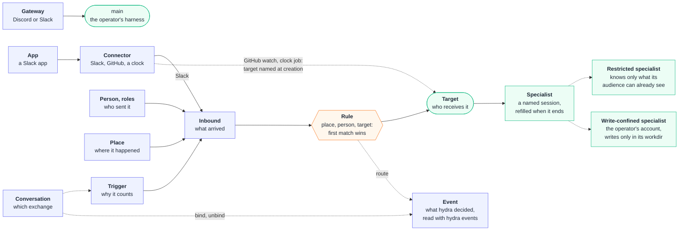

# Concepts

The words hydra uses, and how the pieces connect.

## Core abstractions

Twenty-three names carry the design. Each answers one question.

| Name | Question | Sentence |
|---|---|---|
| Gateway | How does the operator talk to hydra? | A chat platform (Discord or Slack) that carries the operator's messages and commands. One identity: its bot. |
| App | Who hears, who speaks? | A Slack app. Its bot hears where it is a member and is the only one that speaks. The operator's token, if given, hears every channel, DM and group DM the operator is in and never speaks; nothing it hears is delivered unless a place names it. A value that names one says its kind: `app:sales`. |
| App › router | Where does a tag go that nothing else takes? | `router = "main"` or `"specialist:<name>"` on a Slack app: a tag of the app in a channel thread that no binding and no rule takes goes to it, third in order. A specialist so named, the router, hears whoever its own `reachable_by` lets in, may bind the thread to another session, and is never restricted or write-confined. |
| Connector | Where does what arrives from outside come from? | A source of inbounds: Slack, GitHub, a clock. |
| Inbound | What arrived? | One thing that arrived, as routing sees it: who sent it, where, why it counts. |
| Place | Where did it happen? | A channel, a DM or a repository, named `slack:#ops`, `github:owner/repo`. |
| Person, roles | Who sent it? | A name from `[people]`, and the roles it holds. Written with their kind: `person:alice`, `role:finance`. |
| Conversation | Which exchange? | An app, a channel and a thread; what a binding attaches to. |
| Trigger | Why does it count? | The reason an inbound is heard: addressed (a tag or a DM), `messages = "all"`, or bound. |
| Reaction | A person's emoji on a message. | Heard only where the place says `reactions = "bot-messages"` or `"all"` (default `"off"`): then it is delivered, once, to the session that owns the conversation it is in, from a person the rules admit as for a message. |
| Rule | Which inbound goes to which target? | `place`, `person`, then `target`; the first match wins. |
| Target | Who receives it? | main (the operator's harness), a specialist, a session's thread, a conversation's own session, or a new session started from a recipe. A target value says its kind: `main`, `specialist:<name>`, `thread:<id>`. |
| Specialist | Who answers a place? | A named session that hydra refills when it ends. Reached by places, rules, schedules and deliveries. |
| Restricted specialist | What may it know? | A specialist that may know only what its audience can already see (`restricted = true`). A property of a specialist, not a kind of target, and never also write-confined. Its listed servers run under a sandbox proven only on the macOS versions hydra names: on any other, a restricted specialist that lists servers is refused at launch unless `[restricted] allow_unproven_macos = true`. |
| Write-confined specialist | Where may it write? | A specialist on the operator's account and tools whose Bash and Edit/Write writes are confined to its `workdir` (`can_only_write_to = "workdir"`; absent: writes anywhere). Claude Code's tools and shell are also denied the operator's credential places (below). The network, the browser's and MCP servers' own reads and writes, and anything not on that list stay open. A property of a specialist, like restricted, and never both: `Specialist` is restricted, write-confined or neither, and a hydra.toml table that sets both `restricted = true` and `can_only_write_to` does not load. |
| `cannot_read` | What more may it not read? | Paths added to the credential places a write-confined specialist's Claude Code tools and shell are always denied (`~/.ssh`, `~/.aws`, `~/.config/gh`, the keychain, browser profiles, hydra's state folder, other specialists' workdirs). Valid only with `can_only_write_to`; it extends, never replaces, the built-in places. Binds Claude Code's tools and shell, not the browser or MCP servers. |
| `handoff_at_pct` | At what context is its idle session replaced? | A specialist's context percent (1–99): an idle session of it at that line is replaced as its `handoff_protocol` says, whatever the environment says. Read on each health poll, so an edit reaches running sessions; not part of the launch policy, so a change never counts as drift. Its old name, `handoff_at`, fails to load and names the new one. On a restricted or write-confined specialist only with `kill_and_respawn`: their sessions have no handoff tool to write a letter with. |
| `handoff_protocol` | What replaces its session there? | `letter` (the default): the session writes a letter and a successor starts from it. `kill_and_respawn`: hydra ends the session and starts a fresh one in the same thread from the kickoff, with no letter, and no revive (a refill, `resume`, `respawn`, boot recovery) ever resumes or forks the old conversation. The `handoff` command follows it too. |
| Address | Who or where, on which platform? | `platform:thing`, like `slack:U0ALICE` or `slack:#ops`. A Person holds addresses; a Place is one. |
| Pin | Which apps deliver to it? | A specialist's list of Slack apps (`pinned_to`). Only those apps deliver to it, and it takes nothing from the others. |
| Operator | Whose hydra is it? | The Person (`operator = "…"`) whose DMs reach main and who reaches every specialist. |
| Event | What did hydra decide? | One line the daemon appends to `<state dir>/events/<day>.jsonl` when a message is delivered (or a tag is stopped), or a conversation is bound, moved or let go, by someone or by hydra itself with a reason: ids, names and a bind's reason, never message text. Slack routing only for now. Read with `hydra events` (`--kind`, `--since`, `--conversation`, `--by`, `--to`, `--limit`); day files older than `[events] keep_days` days (default 30) are deleted. Its `kind` is `route`, `bind` or `unbind`; a route's `via` is `binding`, `rule`, `router`, `operator-dm`, or, for a tag or a DM with the bot nothing delivered, `none` (no step took it: its sender was refused, no place hears it, or it tags an app that cannot hear it), `guard`, `tag-cap` or `table-full`. |
| Guard | May this sender's message go through? | The operator's command (`[guard]`) that judges a non-operator's Slack message after routing: deliver, redirect, hold or drop. |

A schedule is the one name for a clock that sends a message to a specialist; `job` is its old name. An audience is not a key: it is derived from who `reachable_by` lets reach a specialist, and the places its `[[rules]]` send to it.

In code: the gateways are `gateways/`, what each platform can do is its `GatewayProfile` in `shared/gateways/` (outside the folders that own a platform's name, code that differs by platform asks a capability there), the Slack connector is `connectors/slack/`, an Inbound is `Inbound` in `routing/route.ts`, a Target is `Target` in `app/targets.ts`, and the restricted layer is `app/restricted.ts`. `diagrams/core.mmd` is the picture below; a test checks that every path and symbol named here and in `diagrams/core.mmd` exists.

**Route or name.** Route when the recipient depends on each event's sender and place: Slack, where a rule picks the target per event. Name the target when the subscriber chose it at creation: a GitHub watch or a clock job, set once.
Both end in `deliverToTarget`, so a restricted specialist's audience is checked the same way at delivery (`deliveryRefusal`).
